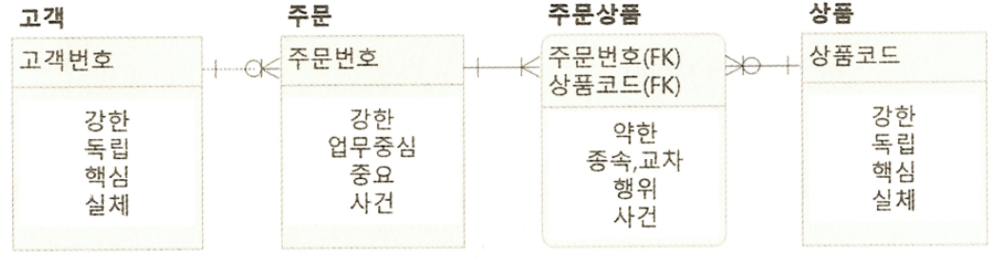
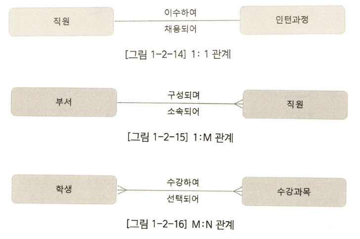
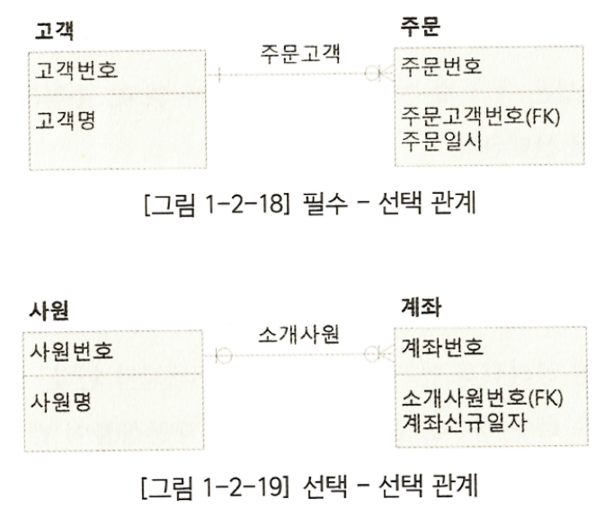
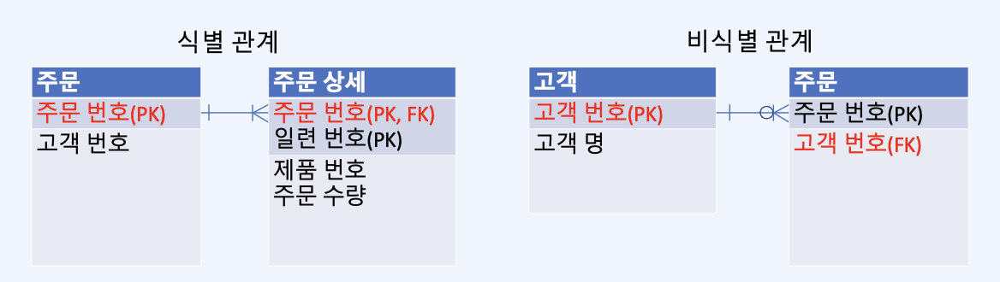
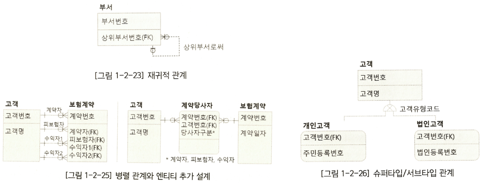

# 데이터베이스 모델링 기초 — ER 모델과 정규화

## 목차

1. [데이터 모델링과 ERD](#1-데이터-모델링과-erd)
2. [ER 모델의 구성 요소](#2-er-모델의-구성-요소)
3. [정규화](#3-정규화)

<br>

## 1. 데이터 모델링과 ERD

**모델링(Modeling)** 은 실제 대상을 **추상화하여 중요한 특징만 단순하게 표현하는 것**이다. **데이터 모델링(Data Modeling)** 은 **실제 업무와 요구사항을 분석하여 필요한 데이터를 도출하고, 데이터의 구조와 관계를 설계하는 과정**이다.

- **데이터 모델(Data Model)**: 데이터를 그룹화하고 그룹 사이의 관계를 나타낸 설계 결과.
- **ER 모델(Entity–Relationship Model)**: 데이터의 구조를 **엔티티(Entity)** 와 **관계(Relationship)** 중심으로 표현하는 모델.
- **ERD(Entity–Relationship Diagram)**: ER 모델을 그림으로 나타낸 것. 엔티티와 속성, 관계, 키 등을 한눈에 확인한다.

예를 들어 쇼핑몰을 모델링한다면 **고객·주문·상품**처럼 관리해야 할 대상을 찾고 **어떤 고객이 어떤 상품을 주문했는가**라는 관계를 설계한다.

**좋은 모델의 기준**은 필요한 업무를 빠짐없이 표현하면서도 **정확하고, 중복이 적고, 읽기 쉬우며, 변경에 대응하기 쉬워야 한다**는 것이다.

<br>

## 2. ER 모델의 구성 요소

**ER 모델(Entity–Relationship Model)** 은 업무에서 관리할 대상과 그 관계를 표현한다. 기본 구성 요소는 **엔티티·관계·속성·식별자** 네 가지다.

| 구성 요소              | 의미                                                  | 예시                   | 관계형 DB에서의 대응 |
| ---------------------- | ----------------------------------------------------- | ---------------------- | -------------------- |
| **엔티티(Entity)**     | 관리할 대상·개념·사건                                 | 학생, 강좌, 수강신청   | 테이블               |
| **관계(Relationship)** | 엔티티 사이의 업무상 연관                             | 학생이 강좌를 수강한다 | FK 등으로 구현       |
| **속성(Attribute)**    | 엔티티가 갖는 정보                                    | 학생명, 강좌명         | 컬럼                 |
| **식별자(Identifier)** | 각 인스턴스를 유일하게 구별하는 속성 또는 속성의 조합 | 학생번호, 강좌번호     | PK 등의 키           |

### 2.1. 엔티티(Entity)

**엔티티**는 업무에서 관리할 필요가 있는 **실존하는 대상 또는 개념적인 대상**이다. 학생·상품·직원처럼 실제 대상일 수도 있고, 주문·결제·수강신청처럼 업무에서 발생하는 사건일 수도 있다.

- **엔티티(Entity)**: 공통된 특성을 가진 데이터를 묶은 대상. 예: 학생
- **인스턴스(Instance)**: 엔티티에 속하는 개별 사례. 예를 들어, '학생번호 101번 학생' 한 명에 해당하며, 테이블에서는 하나의 **행(Row)** 으로 나타난다.

#### 엔티티의 분류

| 분류 관점            | 구분                                      | 의미·예시                                                    |
| -------------------- | ----------------------------------------- | ------------------------------------------------------------ |
| **엔티티 관계**      | **강한(Strong) / 약한(Weak)**             | 자체 식별이 가능한 대상 / 소유 엔티티의 식별자가 필요한 대상 |
| **엔티티 형태**      | **독립 / 업무중심 / 종속 / 교차**         | 고객·상품 / 주문 / 주문상세 / 수강신청                       |
| **엔티티 생성 관점** | **핵심(Key) / 중요(Main) / 행위(Action)** | 고객·상품 / 주문 / 주문상품                                  |
| **엔티티 유형**      | **실체 / 비실체(개념·사건)**              | 대상이 갖는 실체성이나 업무상 의미에 따른 구분               |

<details>
<summary>엔티티 분류별 설명과 예시</summary>

**① 엔티티 형태에 따른 분류**

- **독립 엔티티**: 다른 업무 사건과 별개로 관리하는 기본 대상. 예: **고객, 상품**
- **업무중심 엔티티**: 업무가 진행되는 과정에서 중심이 되는 정보를 관리하며, 다른 엔티티들과 연결되어 업무의 흐름을 나타내는 엔티티. 예: **주문**
- **종속 엔티티**: 다른 엔티티를 전제로 존재하거나 의미가 정해지는 대상. 예: **주문상세**
- **교차 엔티티**: 둘 이상의 엔티티 사이의 관계를 데이터로 관리하는 대상. 예: **학생과 강좌 사이의 수강신청**

**② 엔티티 생성 관점에 따른 분류**

- **핵심 엔티티**: 업무의 기반이 되는 상대적으로 독립적인 데이터. 예: **고객, 상품**
- **중요 엔티티**: 핵심 엔티티를 바탕으로 발생하는 주요 업무 데이터. 예: **주문**
- **행위 엔티티**: 업무 진행에 따라 생성되는 상세·이력 데이터. 예: **주문상품(주문상세)**

**③ 엔티티 관계에 따른 분류 — 식별 의존성**

- **강한 엔티티(Strong Entity)** 는 자체 식별자로 각 인스턴스를 구별한다. 예를 들어 `주문`은 `주문번호`만으로 식별할 수 있다.
- **약한 엔티티(Weak Entity)** 는 소유 엔티티의 식별자가 있어야 각 인스턴스를 구별할 수 있다. 예를 들어 주문마다 `상세순번`을 1부터 매긴다면, `주문상세` 한 건은 `(주문번호, 상세순번)`으로 식별한다.

**④ 엔티티 유형에 따른 분류 — 모델링하는 대상의 성격**

- **실체(Tangible)** 는 물리적인 형태가 있는 대상이다. 예를 들면 직원, 종이책이 있다.
- **비실체(Intangible)** 는 물리적인 형태 없이 업무에서 구분해 관리하는 대상이다.
  - **개념(Conceptual)** 은 업무에서 사용하는 기준이나 분류를 나타낸다. 예를 들면 요금제 유형이 있다.
  - **사건(Event)** 은 업무에서 발생한 일을 나타낸다. 예를 들면 주문, 결제가 있다.



주문상품은 주문에 종속되면서 주문과 상품을 연결한다. 같은 엔티티에 여러 분류가 적용될 수 있다.

</details>

### 2.2. 관계(Relationship)

**관계(Relationship)** 는 **엔티티 간에 존재하는 업무상의 연관성을 나타내며, 서로 어떻게 연결되는지를 표현하는 것**이다.

#### ① 관계수(Cardinality)

**관계수**는 한 엔티티의 인스턴스가 상대 엔티티의 인스턴스 **최대 몇 개**와 연결될 수 있는지를 나타낸다.

| 관계수           | 의미                                                          | 예시                                      |
| ---------------- | ------------------------------------------------------------- | ----------------------------------------- |
| **1:1 (일대일)** | 양방향 모두 상대편 인스턴스와 최대 하나까지 연결되는 관계     | **직원 ↔ 직원별 급여설정(인당 최대 1건)** |
| **1:N (일대다)** | 한쪽의 데이터 하나가 상대편 여러 데이터와 연결될 수 있는 관계 | **고객 1명 → 주문 여러 건**               |
| **M:N (다대다)** | 양쪽 모두 상대편의 여러 데이터와 연결될 수 있는 관계          | **학생 여러 명 ↔ 강좌 여러 개**           |



**M:N 관계는 관계형 테이블을 설계할 때 교차 엔티티를 두어 1:N 관계 두 개로 풀어낸다.**

```text
학생 N ───── M 강좌             (업무상 M:N)
학생 1 ─── N 수강신청 M ─── 1 강좌   (관계형 DB 설계)
              ├─ 학생번호(FK)
              └─ 강좌번호(FK)
```

#### ② 선택성(Optionality) — 필수와 선택

**선택성**은 한 인스턴스가 상대 엔티티의 인스턴스와 **최소 몇 건 연결되어야 하는지**를 나타낸다. 연결이 없어도 되면 **선택(최소 0)**, 적어도 한 건과 연결되어야 하면 **필수(최소 1)** 다.



까마귀발 표기법(Crow’s Foot)은 **한쪽의 인스턴스 한 건을 기준으로 반대쪽 끝의 기호**를 읽는다. 위 그림에서 고객 한 명의 주문 수를 알려면 **주문 쪽 끝**을 본다. 원은 최소 0건, 까마귀발은 여러 건이 가능하다는 뜻이므로 `0..N`으로 읽는다.

| 읽는 방향             | 연결 범위 | 의미                                                       |
| --------------------- | --------- | ---------------------------------------------------------- |
| 고객 한 명 → 주문     | `0..N`    | 고객 한 명의 주문은 0건 이상이다.                          |
| 주문 한 건 → 고객     | `1..1`    | 각 주문에는 주문한 고객이 정확히 한 명 있다.               |
| 사원 한 명 → 계좌     | `0..N`    | 사원이 소개한 계좌는 0개 이상이다.                         |
| 계좌 한 개 → 소개사원 | `0..1`    | 소개사원 없이 개설할 수 있고, 소개사원이 있다면 한 명이다. |

#### ③ 식별 관계와 비식별 관계

엔티티 간 관계에서 부모 엔티티의 PK를 자식 엔티티가 FK로 참조할 때, **해당 FK가 자식의 PK에도 포함되는지**에 따라 관계를 구분한다.

| 구분                             | 의미                                                                     | 예시                |
| -------------------------------- | ------------------------------------------------------------------------ | ------------------- |
| **식별 관계(Identifying)**       | 부모의 PK가 자식의 **PK에도 포함되어**, 자식을 식별하는 데 사용되는 관계 | **주문 → 주문상세** |
| **비식별 관계(Non-identifying)** | 부모의 PK를 **FK로만 참조**하며, 자식은 별도의 PK로 식별되는 관계        | **고객 → 주문**     |



- **식별 관계**: `주문상세`는 `주문번호`와 `일련번호`를 함께 PK로 사용한다. 즉, 어떤 주문에 속한 상세 정보인지 알아야 해당 데이터를 식별할 수 있다.
- **비식별 관계**: `주문`은 `주문번호`만으로 식별할 수 있다. `고객번호`는 어떤 고객의 주문인지 연결하는 FK로만 사용된다.

#### ④ 관계 유형

| 유형                       | 의미                                                                    | 예시                                                |
| -------------------------- | ----------------------------------------------------------------------- | --------------------------------------------------- |
| **기본 관계**              | 서로 다른 엔티티 사이의 일반적인 관계                                   | 고객 → 주문                                         |
| **재귀적 관계**            | **하나의 엔티티가 자기 자신과 관계**를 맺음, (계층 관계 표현 가능)      | 직원 ↔ 상사, 부서 ↔ 상위부서                        |
| **병렬 관계**              | 두 엔티티 사이에 **서로 다른 역할이나 의미를 가진 관계**가 여러 개 존재 | 고객과 보험계약 사이의 계약자·피보험자·수익자 관계. |
| **슈퍼타입/서브타입 관계** | 공통 속성을 상위 엔티티로 묶고 하위 유형으로 세분화                     | 고객 → 개인고객·법인고객                            |



### 2.3. 속성(Attribute)

**속성(Attribute)** 은 **엔티티의 특징이나 정보를 표현하는 가장 작은 단위**이다.

#### 속성 설계 시 고려사항

| 구분                    | 의미                                                          | 예시                           |
| ----------------------- | ------------------------------------------------------------- | ------------------------------ |
| **속성명**              | 속성의 의미가 명확하게 드러나도록 이름을 정한다.              | `학생명`, `입학일자`           |
| **식별자 여부**         | 해당 속성이 엔티티의 인스턴스를 구별하는 식별자인지 결정한다. | `학생번호` (PK)                |
| **선택성(Optionality)** | 속성에 값이 반드시 있어야 하는지 결정한다.                    | `학생명`(필수), `영문명`(선택) |
| **도메인(Domain)**      | 속성에 저장할 수 있는 값의 자료형과 범위를 정한다.            | `학년`: 정수 1~4               |

#### 속성의 분류

속성은 **값의 구성이나 성격**에 따라 다음과 같이 분류한다.

| 분류 기준          | 유형                   | 예시                             |
| ------------------ | ---------------------- | -------------------------------- |
| **값의 구성**      | 단순 속성 / 복합 속성  | 나이 / 주소(시·구·도로명)        |
| **값을 얻는 방법** | 저장 속성 / 파생 속성  | 주문수량·판매단가 / 주문항목금액 |
| **값의 개수**      | 단일 값 / 다중 값 속성 | 생년월일 / 여러 개의 전화번호    |

#### 저장 속성과 파생 속성

주문상세에서 직접 기록하는 주문수량과 판매단가는 저장 속성(Stored Attribute)이다. 두 값을 곱해 구하는 주문항목금액은 파생 속성(Derived Attribute)이다. 계산 결과를 저장해 두어도 다른 값에서 구했다는 점에서 파생 속성이다.

파생값은 조회할 때 계산하거나 미리 계산해 저장할 수 있다. 예를 들어 주문 총액을 저장해 두면 조회할 때마다 주문항목금액을 합산하는 비용을 줄일 수 있다. 다만 주문수량이나 판매단가가 바뀌면 총액도 함께 갱신해야 한다.

### 2.4. 식별자(Identifier)

**식별자**는 한 엔티티에서 **각 인스턴스(행)를 구별**하는 속성 또는 속성의 조합이다.

- **유일성(Uniqueness)**: 같은 엔티티 내 두 행을 구별할 수 있어야 한다.
- **최소성(Minimality)**: 식별에 불필요한 속성을 포함하지 않아야 한다.
- **불변성(Stability)**: 값이 가급적 변경되지 않아야 한다.
- **존재성(Mandatory)**: 식별자 값이 반드시 존재해야 한다.

#### 식별자의 유형

| 분류 관점         | 종류                       | 뜻                                                     | 예시                            |
| ----------------- | -------------------------- | ------------------------------------------------------ | ------------------------------- |
| **식별자의 성격** | **본질 식별자(Natural)**   | 업무에서 이미 사용하는 값으로 대상을 식별한다.         | 도서의 판본을 구별하는 `ISBN`   |
|                   | **인조 식별자(Surrogate)** | 식별을 위해 별도로 생성·부여한 값                      | 자동 발급한 `주문상세번호`      |
| **식별자의 선택** | **주 식별자(Primary)**     | 후보 식별자 가운데 대표로 선택한 것                    | `직원번호`를 PK로 선택          |
|                   | **대체 식별자(Alternate)** | 유일하게 식별할 수 있지만 주 식별자로 선택되지 않은 것 | 다른 후보 식별자인 `사내이메일` |

본질 식별자와 인조 식별자는 업무에서 사용하는 값으로 식별하는지, 식별을 위해 별도의 값을 부여하는지에 따라 구분한다.

#### 관계형 모델의 키

식별자 개념을 **관계형 테이블의 키**로 표현하면 다음과 같다.

| 키                          | 의미                                                                      |
| --------------------------- | ------------------------------------------------------------------------- |
| **후보키(Candidate Key)**   | 유일성·최소성을 만족해 PK로 선택할 수 있는 키                             |
| **기본키(Primary Key, PK)** | 후보키 가운데 대표로 선택한 키. **중복·NULL 불가**                        |
| **대체키(Alternate Key)**   | 후보키 중 **PK로 선택되지 않은 키**. 대체 식별자에 대응                   |
| **슈퍼키(Super Key)**       | 행을 유일하게 식별하는 속성 조합. **최소성은 없어도 됨**                  |
| **외래키(Foreign Key, FK)** | 같은 테이블 또는 다른 테이블의 PK나 UNIQUE 키를 참조해 관계를 표현하는 키 |

#### 무결성 제약조건

키를 실제 테이블에 구현할 때는 데이터의 올바른 상태를 유지하는 제약조건도 함께 고려한다.

- **개체 무결성**: **PK는 중복되거나 `NULL`일 수 없다.**
- **참조 무결성**: 단일 컬럼 FK에 값이 있으면 참조 대상 키에 같은 값이 있어야 한다. 선택 관계라면 FK에 `NULL`을 허용할 수 있고, 필수 관계라면 FK 컬럼에 `NOT NULL`도 지정한다.
- **도메인(영역) 무결성**: 속성의 **자료형·범위 등 허용된 값**만 저장한다. (예: 학년 1~4)

<br>

## 3. 정규화

**정규화(Normalization)** 는 테이블을 분리해 데이터의 불필요한 중복을 줄이는 과정이다. 같은 정보를 여러 곳에 저장할 필요가 줄어 저장 공간을 아낄 수 있고, 삽입·갱신·삭제 이상을 줄여 데이터의 일관성을 유지할 수 있다.

### 정규화가 필요한 이유 — 이상 현상

한 학기의 수강 기록을 다음과 같이 관리한다고 하자. 같은 학생이 같은 과목을 한 번만 수강하므로, 한 행은 `(학번, 과목코드)`로 구별한다.

| 학번 | 학생명 | 학과코드 | 학과명       | 과목코드 | 과목명 | 평점 |
| ---- | ------ | -------- | ------------ | -------- | ------ | ---- |
| 1101 | 민수   | D01      | 컴퓨터공학과 | C01      | DB개론 | A    |
| 1101 | 민수   | D01      | 컴퓨터공학과 | C02      | 통계   | B    |
| 1102 | 지연   | D01      | 컴퓨터공학과 | C01      | DB개론 | B    |

이 표에는 **학생이 어떤 과목을 수강했는지**와 **그 과목의 이름이 무엇인지**가 한 행에 함께 기록된다. 그래서 한쪽 정보만 바꾸려 해도 다음 문제가 생긴다.

- **삽입 이상(Insert Anomaly)** — 수강생이 없는 새 과목을 등록하려 해도 기본키의 일부인 학번이 필요하다.
- **갱신 이상(Update Anomaly)** — `C01`의 이름을 바꾸려면 민수와 지연의 행을 모두 수정해야 한다. 한쪽만 바꾸면 같은 과목의 이름이 서로 달라진다.
- **삭제 이상(Delete Anomaly)** — 민수가 통계 수강을 취소해 두 번째 행을 삭제하면, `C02`의 과목명이 ‘통계’라는 정보까지 사라진다.

### ① 제1정규형(1NF) — 한 칸에 하나의 값

**제1정규형(1NF)** 은 테이블의 각 칸에 하나의 값(원자값)만 저장하는 상태다.

예를 들어 민수의 과목명 한 칸에 `DB개론, 통계`를 함께 적으면 각 과목에 평점을 따로 기록하기 어렵다. 위 표처럼 **한 학생이 한 과목을 수강한 기록을 한 행**으로 나타내면, 민수의 DB개론 평점은 `A`, 통계 평점은 `B`로 각각 기록할 수 있다.

### ② 제2정규형(2NF) — 복합키의 일부만으로 정해지는 정보 분리

**제2정규형(2NF)** 은 제1정규형을 만족하면서, 일반 속성이 복합 후보키의 일부에만 의존하는 **부분 함수 종속(Partial Dependency)** 을 제거한 상태다.

여기서 **함수 종속(Functional Dependency)** 은 한 값이 정해지면 다른 값도 하나로 정해지는 관계다. 예를 들어 `과목코드 → 과목명`은 누가 수강하든 같은 과목코드에는 같은 과목명이 대응한다는 뜻이다.

위 수강 기록의 키는 `(학번, 과목코드)`다. **과목명은 과목코드만으로** 정해지지만, **평점은 학번과 과목코드를 모두 알아야** 정해진다. 같은 과목을 들어도 학생마다 평점이 다를 수 있기 때문이다.

| 결정하는 값     | 정해지는 정보            | 분리한 테이블                          |
| --------------- | ------------------------ | -------------------------------------- |
| 학번            | 학생명, 학과코드, 학과명 | `학생(학번, 학생명, 학과코드, 학과명)` |
| 과목코드        | 과목명                   | `과목(과목코드, 과목명)`               |
| 학번 + 과목코드 | 평점                     | `수강(학번, 과목코드, 평점)`           |

이렇게 분리하면 `C01`의 과목명은 과목 테이블에서 한 번만 관리하고, 수강 테이블에는 학생이 각 과목에서 받은 평점을 기록한다.

### ③ 제3정규형(3NF) — 다른 일반 속성을 거쳐 정해지는 정보 분리

**제3정규형(3NF)** 은 제2정규형을 만족하면서, 일반 속성이 키가 아닌 다른 속성을 거쳐 키에 종속되는 **이행 함수 종속(Transitive Dependency)**을 제거한 상태다.

예를 들어 학생마다 소속 학과가 하나라면, 학번으로 학과코드가 정해지고 학과코드로 학과명이 정해진다(`학번 → 학과코드 → 학과명`). 여기서 학과명은 학과코드만으로 결정되므로, 학생마다 반복해서 저장할 필요가 없다.

따라서 `학생(학번, 학생명, 학과코드)`과 `학과(학과코드, 학과명)`로 분리한다. 이렇게 하면 학과명이 바뀌어도 학과 테이블에서 한 행만 수정하면 된다.

### 반정규화는 언제 고려하는가?

**반정규화(역정규화, Denormalization)** 는 조회를 빠르게 하기 위해 일부 데이터를 중복 저장하거나 계산 결과를 미리 저장하는 방법이다.

예를 들어 과목별 수강 인원을 저장해 두면 조회할 때마다 수강 기록을 셀 필요가 없다. 대신 수강 신청이나 취소가 있을 때마다 인원도 함께 갱신해야 정확한 값을 유지할 수 있다.

그래서 먼저 실제로 느린 쿼리와 인덱스를 점검한다. 그래도 같은 조인이나 집계에 시간이 많이 든다면, **조회에서 절약하는 비용과 데이터를 갱신할 때 추가되는 비용**을 비교해 반정규화를 결정한다.
