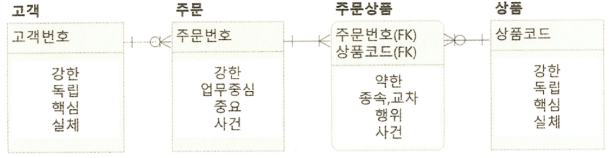
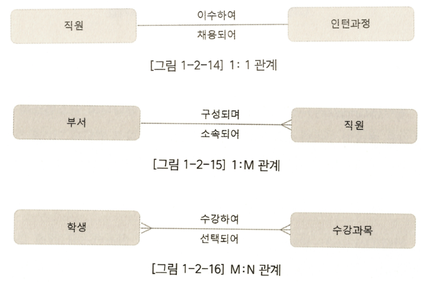
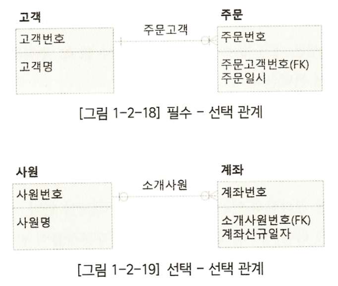
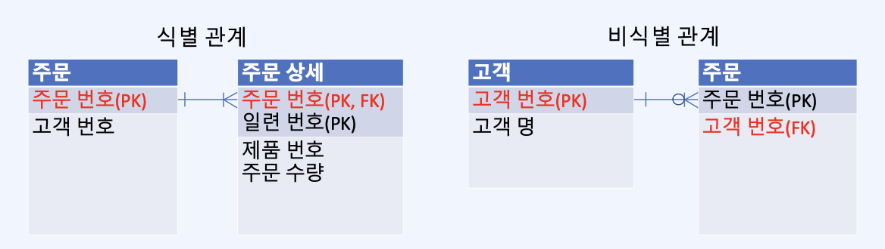
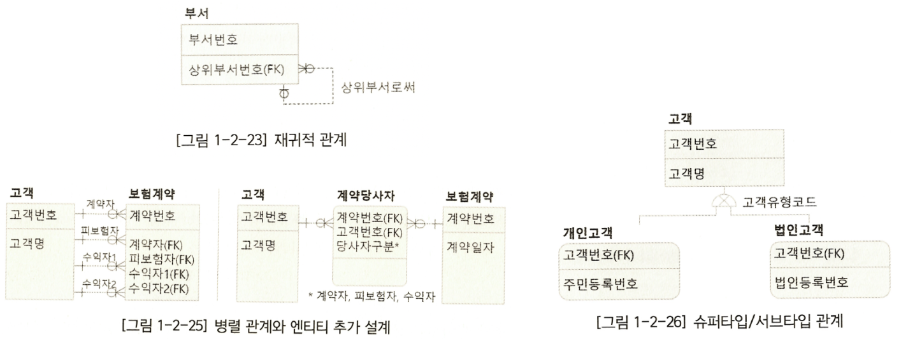

# 데이터베이스 모델링 기초 — ER 모델과 정규화

## 목차

1. [데이터 모델링과 ERD](#1-데이터-모델링과-erd)
2. [ER 모델의 구성 요소](#2-er-모델의-구성-요소)
3. [정규화](#3-정규화)

<br>

## 1. 데이터 모델링과 ERD

**모델링(Modeling)** 은 실제 대상을 **추상화하여 중요한 특징만 단순하게 표현하는 것**이다. **데이터 모델링(Data Modeling)** 은 **실제 업무와 요구사항을 분석하여 필요한 데이터를 도출하고, 데이터의 구조와 관계를 설계하는 과정**이다.

- **데이터 모델(Data Model)**: 데이터를 그룹화하고 그룹 사이의 관계를 나타낸 설계 결과.
- **ER 모델(Entity–Relationship Model)**: 데이터의 구조를 **엔티티(Entity)** 와 **관계(Relationship)** 중심으로 표현하는 모델.
- **ERD(Entity–Relationship Diagram)**: ER 모델을 그림으로 나타낸 것. 엔티티와 속성, 관계, 키 등을 한눈에 확인한다.

예를 들어 쇼핑몰을 모델링한다면 **고객·주문·상품**처럼 관리해야 할 대상을 찾고 **어떤 고객이 어떤 상품을 주문했는가**라는 관계를 설계한다.

**좋은 모델의 기준**은 필요한 업무를 빠짐없이 표현하면서도 **정확하고, 중복이 적고, 읽기 쉬우며, 변경에 대응하기 쉬워야 한다**는 것이다.

<br>

## 2. ER 모델의 구성 요소

**ER 모델(Entity–Relationship Model)**은 업무에서 관리할 대상과 그 관계를 표현한다. 기본 구성 요소는 **엔티티·관계·속성·식별자** 네 가지다.

| 구성 요소              | 의미                      | 예시                   | 관계형 DB에서의 대응 |
| ---------------------- | ------------------------- | ---------------------- | -------------------- |
| **엔티티(Entity)**     | 관리할 대상·개념·사건     | 학생, 강좌, 수강신청   | 테이블               |
| **관계(Relationship)** | 엔티티 사이의 업무상 연관 | 학생이 강좌를 수강한다 | FK 등으로 구현       |
| **속성(Attribute)**    | 엔티티가 갖는 정보        | 학생명, 강좌명         | 컬럼                 |
| **식별자(Identifier)** | 각 인스턴스를 구별하는 값 | 학생번호, 강좌번호     | PK 등의 키           |

### 2.1. 엔티티(Entity)

**엔티티**는 업무에서 관리할 필요가 있는 **실존하는 대상 또는 개념적인 대상**이다. 학생·상품·직원처럼 실제 대상일 수도 있고, 주문·결제·수강신청처럼 업무에서 발생하는 사건일 수도 있다.

- **엔티티(Entity)**: 공통된 특성을 가진 데이터를 묶은 대상 ex) 학생
- **인스턴스(Instance)**: 엔티티에 속하는 개별 사례. 예를 들어, '학생번호 101번 학생' 한 명에 해당하며, 테이블에서는 하나의 **행(Row)**으로 나타난다.

#### 엔티티의 분류

| 분류 관점            | 구분                                      | 의미·예시                                                               |
| -------------------- | ----------------------------------------- | ----------------------------------------------------------------------- |
| **엔티티 관계**      | **강한(Strong) / 약한(Weak)**             | 독립적으로 식별·관리되는 대상 / 다른 엔티티에 의존해 식별·관리되는 대상 |
| **엔티티 형태**      | **독립 / 업무중심 / 종속 / 교차**         | 고객·상품 / 주문 / 주문상세 / 수강신청                                  |
| **엔티티 생성 관점** | **핵심(Key) / 중요(Main) / 행위(Action)** | 고객·상품 / 주문 / 주문상품                                             |
| **엔티티 유형**      | **실체 / 비실체(개념·사건)**              | 대상이 갖는 실체성이나 업무상 의미에 따른 구분                          |

**① 엔티티 형태에 따른 분류**

- **독립 엔티티**: 다른 업무 사건과 별개로 관리하는 기본 대상. 예: **고객, 상품**
- **업무중심 엔티티**: 업무가 진행되는 과정에서 중심이 되는 정보를 관리하며, 다른 엔티티들과 연결되어 업무의 흐름을 나타내는 엔티티. 예: **주문**
- **종속 엔티티**: 다른 엔티티를 전제로 존재하거나 의미가 정해지는 대상. 예: **주문상세**
- **교차 엔티티**: 둘 이상의 엔티티 사이의 관계를 데이터로 관리하는 대상. 예: **학생과 강좌 사이의 수강신청**

**② 엔티티 생성 관점에 따른 분류**

- **핵심 엔티티**: 업무의 기반이 되는 상대적으로 독립적인 데이터. 예: **고객, 상품**
- **중요 엔티티**: 핵심 엔티티를 바탕으로 발생하는 주요 업무 데이터. 예: **주문**
- **행위 엔티티**: 업무 진행에 따라 생성되는 상세·이력 데이터. 예: **주문상품(주문상세)**

<br>

<details>
<summary>엔티티 관계·유형에 따른 분류</summary>

- **강한 엔티티 / 약한 엔티티**: 독립적인 식별·존재 가능성이 큰 엔티티와, 다른 엔티티에 식별이나 존재가 의존하는 엔티티를 구분한다. 예: 주문과 주문상세.
- **실체(Tangible)**: 실제로 존재하며 물리적인 형태가 있는 대상. 예: **상품, 직원**
- **비실체(Intangible)**: 물리적인 형태는 없지만, 독립적으로 구분하고 관리할 수 있는 대상. 예: **디지털 이용권**
  - **개념(Conceptual)**: 업무에서 사용하는 기준이나 분류를 나타내는 대상. 예: **요금제 유형**
  - **사건(Event)**: 업무 과정에서 실제로 발생한 일을 기록하는 대상. 예: **주문, 결제**


주문상품은 주문에 종속되면서 주문과 상품을 연결한다. 같은 엔티티에 여러 분류가 적용될 수 있다.

</details>

### 2.2. 관계(Relationship)

**관계(Relationship)** 는 **엔티티 간에 존재하는 업무상의 연관성을 나타내며, 서로 어떻게 연결되는지를 표현하는 것**이다.

#### ① 관계수(Cardinality)

**관계수**는 한 엔티티의 인스턴스가 상대 엔티티의 인스턴스 **최대 몇 개**와 연결될 수 있는지를 나타낸다.

| 관계수           | 의미                                                          | 예시                                      |
| ---------------- | ------------------------------------------------------------- | ----------------------------------------- |
| **1:1 (일대일)** | 양방향 모두 상대편 인스턴스와 최대 하나까지 연결되는 관계     | **직원 ↔ 직원별 급여설정(인당 최대 1건)** |
| **1:N (일대다)** | 한쪽의 데이터 하나가 상대편 여러 데이터와 연결될 수 있는 관계 | **고객 1명 → 주문 여러 건**               |
| **M:N (다대다)** | 양쪽 모두 상대편의 여러 데이터와 연결될 수 있는 관계          | **학생 여러 명 ↔ 강좌 여러 개**           |



**M:N 관계는 관계형 테이블을 설계할 때 교차 엔티티를 두어 1:N 관계 두 개로 풀어낸다.**

```text
학생 N ───── M 강좌             (업무상 M:N)

학생 1 ─── N 수강신청 M ─── 1 강좌   (관계형 DB 설계)
              ├─ 학생번호(FK)
              └─ 강좌번호(FK)
```

#### ② 선택성(Optionality) — 필수, 선택

**선택성**은 상대 엔티티의 인스턴스가 **반드시 있어야 하는지**를 나타낸다.

- **필수(Mandatory)**: 반드시 연결된 인스턴스가 있어야 한다. 예: 주문에는 고객이 한 명 필요하다.
- **선택(Optional)**: 연결된 인스턴스가 없어도 된다. 예: 고객은 아직 주문을 하지 않았을 수 있다.

까마귀발 표기법(Crow’s Foot)에서는 상대편 끝의 기호를 읽는다. 원은 최소 0, 막대는 위치에 따라 최소 1 또는 최대 1, 까마귀발은 최대 여러 개를 뜻한다.

- **고객 → 주문**: 한 고객은 주문이 **0건 이상**일 수 있다. (선택)
- **주문 → 고객**: 하나의 주문에는 고객이 **정확히 1명** 필요하다. (필수)



아래쪽 예에서 사원 한 명이 소개한 계좌는 0개 이상이고, 계좌 한 개의 소개사원은 0명 또는 1명이다.

#### ③ 식별 관계와 비식별 관계

엔티티 간 관계에서 부모 엔티티의 PK를 자식 엔티티가 FK로 참조할 때, **해당 FK가 자식의 PK에도 포함되는지**에 따라 관계를 구분한다.

| 구분                             | 의미                                                                     | 예시                |
| -------------------------------- | ------------------------------------------------------------------------ | ------------------- |
| **식별 관계(Identifying)**       | 부모의 PK가 자식의 **PK에도 포함되어**, 자식을 식별하는 데 사용되는 관계 | **주문 → 주문상세** |
| **비식별 관계(Non-identifying)** | 부모의 PK를 **FK로만 참조**하며, 자식은 별도의 PK로 식별되는 관계        | **고객 → 주문**     |

- **식별 관계**: `주문상세`는 `주문번호`와 `일련번호`를 함께 PK로 사용한다. 즉, 어떤 주문에 속한 상세 정보인지 알아야 해당 데이터를 식별할 수 있다.
- **비식별 관계**: `주문`은 `주문번호`만으로 식별할 수 있다. `고객번호`는 어떤 고객의 주문인지 연결하는 FK로만 사용된다.



#### ④ 관계 유형

| 유형                       | 의미                                                                    | 예시                                                |
| -------------------------- | ----------------------------------------------------------------------- | --------------------------------------------------- |
| **기본 관계**              | 서로 다른 엔티티 사이의 일반적인 관계                                   | 고객 → 주문                                         |
| **재귀적 관계**            | **하나의 엔티티가 자기 자신과 관계**를 맺음, (계층 관계 표현 가능)      | 직원 ↔ 상사, 부서 ↔ 상위부서                        |
| **병렬 관계**              | 두 엔티티 사이에 **서로 다른 역할이나 의미를 가진 관계**가 여러 개 존재 | 고객과 보험계약 사이의 계약자·피보험자·수익자 관계. |
| **슈퍼타입/서브타입 관계** | 공통 속성을 상위 엔티티로 묶고 하위 유형으로 세분화                     | 고객 → 개인고객·법인고객                            |



### 2.3. 속성(Attribute)

**속성(Attribute)** 은 **엔티티의 특징이나 정보를 표현하는 가장 작은 단위**이다.

#### 속성 설계 시 고려사항

| 구분                    | 의미                                                          | 예시                           |
| ----------------------- | ------------------------------------------------------------- | ------------------------------ |
| **속성명**              | 속성의 의미가 명확하게 드러나도록 이름을 정한다.              | `학생명`, `입학일자`           |
| **식별자 여부**         | 해당 속성이 엔티티의 인스턴스를 구별하는 식별자인지 결정한다. | `학생번호` (PK)                |
| **선택성(Optionality)** | 속성에 값이 반드시 있어야 하는지 결정한다.                    | `학생명`(필수), `영문명`(선택) |
| **도메인(Domain)**      | 속성에 저장할 수 있는 값의 자료형과 범위를 정한다.            | `학년`: 정수 1~4               |

#### 속성의 분류

속성은 **값의 구성이나 성격**에 따라 다음과 같이 분류한다.

| 분류 기준          | 유형                   | 예시                             |
| ------------------ | ---------------------- | -------------------------------- |
| **값의 구성**      | 단순 속성 / 복합 속성  | 나이 / 주소(시·구·도로명)        |
| **값을 얻는 방법** | 저장 속성 / 파생 속성  | 주문수량·판매단가 / 주문항목금액 |
| **값의 개수**      | 단일 값 / 다중 값 속성 | 생년월일 / 여러 개의 전화번호    |

#### 저장 속성과 파생 속성

주문상세에서 직접 기록하는 주문수량과 판매단가는 저장 속성(Stored Attribute)의 예다. 두 값을 곱해 얻는 주문항목금액은 파생 속성(Derived Attribute)이다.

**보충 설명** — 파생값은 조회할 때 계산하거나 계산 결과를 저장해 둘 수 있다. 저장해 두면 수량이나 단가를 수정할 때 금액도 일치하도록 관리해야 한다.

### 2.4. 식별자(Identifier)

**식별자**는 한 엔티티에서 **각 인스턴스(행)를 구별**하는 속성 또는 속성의 조합이다.

- **유일성(Uniqueness)**: 같은 엔티티 내 두 행을 구별할 수 있어야 한다.
- **최소성(Minimality)**: 식별에 불필요한 속성을 포함하지 않아야 한다.
- **불변성(Stability)**: 값이 가급적 변경되지 않아야 한다.
- **존재성(Mandatory)**: 식별자 값이 반드시 존재해야 한다.

#### 식별자의 유형

| 분류 관점         | 종류                       | 뜻                                                     | 예시                                     |
| ----------------- | -------------------------- | ------------------------------------------------------ | ---------------------------------------- |
| **식별자의 성격** | **본질 식별자(Natural)**   | 업무 데이터 자체에서 식별 가능한 값 또는 조합          | 주문상세의 (`주문번호`, `상품코드`) 조합 |
|                   | **인조 식별자(Surrogate)** | 식별을 위해 별도로 생성·부여한 값                      | 자동 발급한 `주문상세번호`               |
| **식별자의 선택** | **주 식별자(Primary)**     | 후보 식별자 가운데 대표로 선택한 것                    | `직원번호`를 PK로 선택                   |
|                   | **대체 식별자(Alternate)** | 유일하게 식별할 수 있지만 주 식별자로 선택되지 않은 것 | 다른 후보 식별자인 `사내이메일`          |

본질 식별자 vs 인조 식별자는 **값을 어디서 얻는가의 구분**이고, 주 식별자 vs 대체 식별자는 **후보 중 무엇을 대표로 쓰는가**의 구분이다.

#### 관계형 모델의 키

식별자 개념을 **관계형 테이블의 키**로 표현하면 다음과 같다.

| 키                          | 의미                                                                      |
| --------------------------- | ------------------------------------------------------------------------- |
| **후보키(Candidate Key)**   | 유일성·최소성을 만족해 PK로 선택할 수 있는 키                             |
| **기본키(Primary Key, PK)** | 후보키 가운데 대표로 선택한 키. **중복·NULL 불가**                        |
| **대체키(Alternate Key)**   | 후보키 중 **PK로 선택되지 않은 키**. 대체 식별자에 대응                   |
| **슈퍼키(Super Key)**       | 행을 유일하게 식별하는 속성 조합. **최소성은 없어도 됨**                  |
| **외래키(Foreign Key, FK)** | 같은 테이블 또는 다른 테이블의 PK나 UNIQUE 키를 참조해 관계를 표현하는 키 |

#### 무결성 제약조건

키를 실제 테이블에 구현할 때는 데이터의 올바른 상태를 유지하는 제약조건도 함께 고려한다.

- **개체 무결성**: **PK는 중복되거나 `NULL`일 수 없다.**
- **참조 무결성**: 단일 컬럼 FK에 값이 있으면 참조 대상 키에 같은 값이 있어야 한다. 선택 관계라면 FK에 `NULL`을 허용할 수 있고, 필수 관계라면 FK 컬럼에 `NOT NULL`도 지정한다.
- **도메인(영역) 무결성**: 속성의 **자료형·범위 등 허용된 값**만 저장한다. (예: 학년 1~4)

<br>

## 3. 정규화

**정규화(Normalization)** 는 기존 테이블을 분리해 **불필요한 중복과 데이터 변경 시 발생하는 문제(이상 현상)**를 줄이는 설계 과정이다.

### 정규화가 필요한 이유: 중복과 이상 현상

직원마다 부서 이름을 함께 저장하면 같은 부서명이 여러 번 반복될 수 있다.

| 직원번호 | 직원명 | 부서번호 | 부서명 |
| -------- | ------ | -------- | ------ |
| 1        | 민수   | D10      | 개발팀 |
| 2        | 지연   | D10      | 개발팀 |
| 3        | 수현   | D20      | 기획팀 |

이 상태에서는 다음 문제가 발생할 수 있다.

- **수정 이상(Update Anomaly)**: 개발팀 이름을 변경하려면 해당 직원 행을 전부 수정해야 한다. 일부만 바꾸면 불일치가 생긴다.
- **삽입 이상(Insert Anomaly)**: 직원이 아직 없는 새 부서 정보를 등록하기 어렵다.
- **삭제 이상(Delete Anomaly)**: 어떤 부서의 마지막 직원을 삭제할 때 부서 정보까지 사라질 수 있다.

`직원(직원번호, 직원명, 부서번호)`와 `부서(부서번호, 부서명)`로 분리하면 부서명은 **부서 테이블에서 한 번만** 관리할 수 있다.

### 제1정규형(1NF) — 한 칸에 하나의 값

**규칙: 각 컬럼 값은 관계형 모델에서 하나의 원자값으로 취급되어야 한다.**

다음처럼 주문상품을 한 셀에 목록으로 저장하면 상품별 검색·수정이 어렵다.

| 주문번호 | 고객번호 | 주문상품           |
| -------- | -------- | ------------------ |
| 1001     | C01      | `P01 2개, P02 1개` |

상품마다 별도 행으로 표현하면 원자값으로 관리할 수 있다.

| 주문번호 | 고객번호 | 상품번호 | 수량 |
| -------- | -------- | -------- | ---: |
| 1001     | C01      | P01      |    2 |
| 1001     | C01      | P02      |    1 |

### 제2정규형(2NF) — 복합키의 일부에만 의존하는 속성 분리

**규칙: 1NF를 만족하고, 어느 후보키에도 속하지 않는 속성이 후보키의 일부분에만 의존하는 부분 함수 종속을 제거한다.** 특히 **복합키**를 쓰는 테이블에서 이해하기 쉽다.

이 예제에서는 한 주문에 같은 상품을 한 줄로 합산한다. `주문상세`의 PK가 (`주문번호`, `상품번호`)일 때 다음처럼 저장했다고 해보자.

| 주문번호(PK) | 상품번호(PK) | 상품명 | 수량 |
| ------------ | ------------ | ------ | ---: |
| 1001         | P01          | 키보드 |    2 |
| 1001         | P02          | 마우스 |    1 |
| 1002         | P01          | 키보드 |    1 |

- **수량**은 어떤 주문의 어떤 상품인지 **둘 다** 알아야 결정된다 → (`주문번호`, `상품번호`)에 의존.
- **상품명**은 **상품번호만** 알면 결정된다 → 복합키 전체가 아닌 일부에 의존.

따라서 상품명을 분리한다.

```text
상품(PRODUCT)               상품번호(PK), 상품명
주문상세(ORDER_ITEM)         주문번호(PK/FK), 상품번호(PK/FK), 수량
```

이제 `P01`의 상품명을 바꿀 때 **상품 테이블 한 곳만** 수정하면 된다. `주문일자`처럼 주문번호만으로 결정되는 속성도 주문 테이블로 분리한다.

**핵심: 2NF는 '복합키의 일부만 알면 정해지는 정보를 따로 빼는 것'이다.**

### 제3정규형(3NF) — 일반 속성을 거쳐 결정되는 값 분리

**규칙: 2NF를 만족하고, 키가 아닌 다른 속성을 거쳐 결정되는 비키 속성의 이행 종속을 제거한다.**

**보충 설명** — 엄밀히는 모든 비자명한 함수 종속 `X → A`에서 X가 슈퍼키이거나 A가 어떤 후보키에 포함되어야 3NF를 만족한다. 아래 예제에서는 주문번호만 후보키다.

이번에는 주문 테이블을 보자.

| 주문번호(PK) | 고객번호 | 고객명 |
| ------------ | -------- | ------ |
| 1001         | C01      | 홍길동 |
| 1002         | C01      | 홍길동 |
| 1003         | C02      | 김영희 |

- `주문번호 → 고객번호`: 주문이 누구의 것인지 결정된다.
- `고객번호 → 고객명`: 고객번호로 고객명이 결정된다.
- 따라서 `주문번호 → 고객번호 → 고객명`으로 **중간 속성을 거쳐** 고객명이 결정된다.

고객명을 주문에 반복 저장하지 않고 고객 테이블로 분리한다.

```text
고객(CUSTOMER)              고객번호(PK), 고객명
주문(ORDERS)                주문번호(PK), 고객번호(FK)
상품(PRODUCT)               상품번호(PK), 상품명
주문상세(ORDER_ITEM)         주문번호(PK/FK), 상품번호(PK/FK), 수량
```

이제 같은 고객이 여러 주문을 하더라도 고객명은 **고객 테이블에서 한 번만** 관리한다.

**핵심: 3NF는 '키가 아닌 속성에 의해 결정되는 정보를 따로 빼는 것'이다.**

### 세 가지 정규형을 한눈에

| 정규형  | 해결할 문제                                | 기억할 문장                 |
| ------- | ------------------------------------------ | --------------------------- |
| **1NF** | 한 칸에 여러 값을 묶어 저장                | **값을 하나씩**             |
| **2NF** | 복합키의 일부에만 의존하는 정보의 반복     | **키 전체에 의존**          |
| **3NF** | 키가 아닌 속성을 거쳐 결정되는 정보의 반복 | **중간 속성을 거치지 않기** |

<details>
<summary>💡 함수 종속이란? </summary>

`X → Y`는 **X 값이 정해지면 Y 값이 하나로 결정된다**는 뜻이다.

- `상품번호 → 상품명`: 상품번호 하나로 해당 상품명이 결정됨.
- `(주문번호, 상품번호) → 수량`: 어떤 주문의 어떤 상품인지 알아야 수량이 결정됨.
- `주문번호 → 고객번호 → 고객명`: 고객번호를 통해 고객명이 간접적으로 결정됨.

</details>

### 역정규화는 언제?

정규화하면 데이터 중복이 줄지만, 여러 테이블을 연결해서 읽어야 할 수도 있다. **측정된 조회 성능 문제**가 있을 때는 집계값 저장이나 중복 컬럼 도입 등 역정규화를 검토할 수 있다.

단, 중복 데이터를 저장하면 **갱신 시 일관성을 유지할 책임도 생긴다.** 따라서 '조인이 생기면 무조건 역정규화'가 아니라 실제 성능과 업무 요구를 보고 결정한다.
