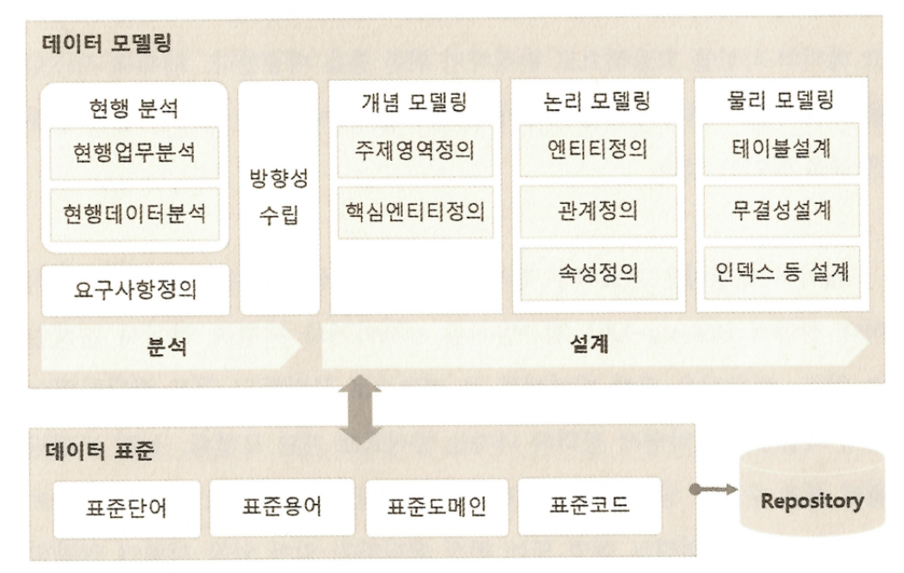
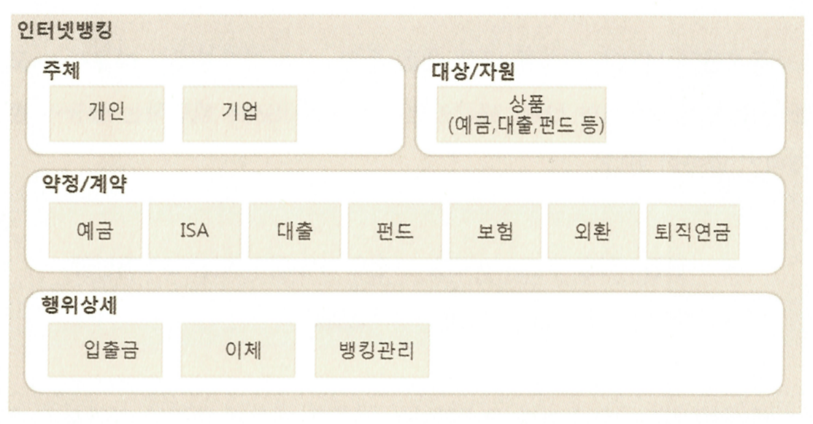

# 2장. 개념 모델링

1. [데이터 모델링의 전체 과정](#1-데이터-모델링의-전체-과정)
2. [개념 모델링이란?](#2-개념-모델링이란)
3. [주제영역 도출·분류·정의](#3-주제영역-도출분류정의)
4. [핵심 엔티티 식별하기](#4-핵심-엔티티-식별하기)
5. [주요 관계 파악하기](#5-주요-관계-파악하기)
6. [식별자와 주요 속성 정의하기](#6-식별자와-주요-속성-정의하기)

## 1. 데이터 모델링의 전체 과정

데이터 모델링은 현재 업무와 요구사항을 파악하는 데서 시작한다. 이후 개념·논리·물리 모델링을 거치며 업무에서 쓰는 개념을 데이터베이스에 구현할 수 있는 구조로 구체화한다.

| 단계                     | 이 단계에서 하는 일                                                                                |
| ------------------------ | -------------------------------------------------------------------------------------------------- |
| 현행 분석 및 방향성 수립 | 기존 화면·문서·데이터를 살펴보고 현업 담당자와 함께 유지할 업무 규칙과 개선할 요구사항을 정리한다. |
| **개념 모델링**          | 요구사항에서 주제영역과 핵심 엔티티를 찾고 주요 관계를 표현한다.                                   |
| 논리 모델링              | 엔티티별 식별자·속성과 관계를 상세히 정의해 업무 규칙을 모델에 반영한다.                           |
| 물리 모델링              | 사용할 DBMS에 맞춰 테이블·컬럼·제약조건·인덱스를 설계한다.                                         |

 

## 2. 개념 모델링이란?

**개념 모델링(Conceptual Data Modeling)은 업무 요구사항을 바탕으로 전체 데이터의 구조를 큰 틀에서 설계하는 단계다.** 관련 데이터를 주제영역으로 묶고, 각 영역에서 관리할 핵심 엔티티와 그 사이의 관계를 정한다.

 

## 3. 주제영역 도출·분류·정의

**주제영역(Subject Area)** 은 업무상 관련이 깊은 데이터를 묶은 범위다. 업무가 크면 영역을 계층적으로 나누고, 각 영역에 어떤 정보까지 포함할지 정한다.

| 단계 | 단계별 핵심 내용                                                                                                              |
| ---- | ----------------------------------------------------------------------------------------------------------------------------- |
| 도출 | 가입·조회 메뉴와 업무 자료를 살펴보고 고객 정보, 상품 정보, 계좌 정보처럼 업무에서 관리해야 할 정보 묶음을 찾는다.            |
| 분류 | 같은 고객이 예금과 대출에 모두 등장해도 고객 정보는 한데 모은다. 고객은 업무의 주체, 금융상품은 가입 대상으로 구분할 수 있다. |
| 정의 | 각 영역이 어떤 정보를 다루고 어디까지 관리하는지 한두 문장으로 정리한다. 이웃 영역과 범위가 겹치면 경계를 조정한다.           |

 

## 4. 핵심 엔티티 식별하기

주제영역별로 **업무에서 개별적으로 구분해 관리해야 하는 대상이나 사건**을 찾는다. 엔티티(Entity) 후보를 찾으면 그 엔티티의 한 건이 실제 업무에서 무엇을 뜻하는지 한 문장으로 정의한다.

 

## 5. 주요 관계 파악하기

업무 흐름을 따라 **어떤 엔티티들이 서로 연결되고 그 연결이 무엇을 뜻하는지** 확인한다. 두 엔티티를 업무에서 쓰는 동사로 연결해 문장을 만들면 관계(Relationship)의 의미가 드러난다. 관계수와 선택성 등 세부 규칙은 논리 모델링에서 구체화한다.

 

## 6. 식별자와 주요 속성 정의하기

**식별자(Identifier)** 는 각 건을 유일하게 구별하는 속성 또는 속성의 조합이다. 한 건의 의미를 기준으로 무엇이 그 건을 구별하는지 확인하고, 업무에서 그 건에 대해 알아야 할 **주요 속성(Attribute)**을 정한다. 이 단계에서는 현업 담당자가 모델을 보고 업무 의미를 확인할 수 있을 정도면 충분하다.

 

예시) 극장 예매

1. **요구사항** — 관객은 같은 상영관에서도 날짜와 시간에 따라 다른 상영을 선택할 수 있다.
2. **주제영역** — 극장시설 관리는 극장·상영관·좌석의 구성을 다룬다. 상영 운영 관리는 어느 상영관에 어떤 영화를 언제 편성하는지 다룬다.
3. **핵심 엔티티와 관계** — 상영관 한 건은 물리적인 공간 하나이고, 상영회차 한 건은 그 공간에 편성된 상영 한 번이다. 한 상영관에는 여러 회차를 편성할 수 있고, 각 회차는 한 상영관에서 진행된다.
4. **식별자와 속성** — 회차마다 부여하는 상영회차ID로 각 상영을 구별한다. 같은 상영관에서 오전·오후 회차의 시작 시각이 다르므로 상영시작일시는 상영회차의 속성이다.

 

### 참고 자료

핵심 데이터 모델링
