# 3장. 논리 모델링

1. [논리 모델링 개요](#1-논리-모델링-개요)
2. [핵심 엔티티와 파생 엔티티](#2-핵심-엔티티와-파생-엔티티)
3. [엔티티 도출과 정의](#3-엔티티-도출과-정의)
4. [엔티티 통합과 데이터 통합](#4-엔티티-통합과-데이터-통합)
5. [관계, 속성, 식별자, 도메인 도출 및 정의](#5-관계-속성-식별자-도메인-도출-및-정의)
6. [데이터 모델 검토](#6-데이터-모델-검토)
7. [데이터 표준화](#7-데이터-표준화)

 

## 1. 논리 모델링 개요

**논리 모델링**(Logical Data Modeling)은 개념 모델링에서 파악한 핵심 엔티티와 주요 관계를 바탕으로, 업무 규칙을 반영해 데이터 구조를 구체화하는 단계다.

- 비즈니스 전체 영역의 데이터 구조를 상세하게 설계한다.
- 주제영역 단위로 논리 모델링을 진행한다.
- 핵심 엔티티를 중심으로 하위 엔티티까지 확장한다.
- DBMS의 물리적 특성은 물리 모델링에서 고려한다.
- 개념 모델과 구조적 일관성을 유지한다. 핵심 엔티티나 주요 관계가 달라지면 개념 모델에도 반영한다.

 

## 2. 핵심 엔티티와 파생 엔티티

### 핵심 엔티티

**핵심 엔티티**(Key Entity)는 업무에서 독립적으로 식별하고 관리하는 기준 정보를 말한다.

- 유형 및 분류(type & category): 고객 유형 코드, 상품 분류(대중소)
- 업무 규칙 및 지식(rule & knowledge): 보험료 조건, 직급별 연봉, 환불 정책
- 업무 주체 및 대상(subject & object): 고객, 상품, 사원, 예금
- 장소(where): 물류창고, 공장, 강의장

ex) 고객은 누구인가? 비회원도 고객? 외국인도 고객? 고객을 등록하기 위한 최소한의 정보는?

### 파생 엔티티

**파생 엔티티**는 핵심 엔티티와 관련된 정보를 별도로 관리하기 위한 엔티티이다. 대표적인 유형으로는 상세, 상태, 이력, 교차 엔티티가 있다.

예를 들어, 사무용품 구매 승인을 요청하는 품의서에 ‘복사용지 3상자’와 ‘토너 2개’를 적을 수 있다. 이때 승인 요청은 한 번이므로 `품의`는 한 건이고, 구매 항목은 두 가지이므로 `품의내역`은 두 건이다.

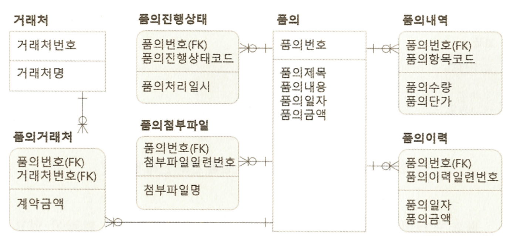

- **상세 엔티티 — 품의내역**  
  품의 제목과 작성일은 품의 한 건에 대해 한 번만 기록한다. 수량과 단가는 품목마다 다를 수 있으므로 `품의내역`에 항목별로 기록한다.

- **상태 엔티티 — 품의진행상태**  
  품의가 어떤 단계를 거쳤는지 알 수 있도록 진행상태와 처리 일시를 기록한다. 예를 들어 검토를 거쳐 승인됐다면, 언제 검토했고 언제 승인했는지 확인할 수 있다.

- **품의첨부파일**  
  품의서에 견적서나 제품 사양서처럼 여러 파일을 첨부할 수 있다. `품의첨부파일`은 파일 하나를 한 건으로 관리하므로, 같은 품의에 견적서 두 개를 첨부하면 두 건이 생긴다.

- **이력 엔티티 — 품의이력**  
  같은 품의에 대해 이력을 남길 때마다 그때의 품의일자와 품의금액을 한 건으로 기록한다. 각 기록은 이력일련번호로 구분하므로 이전에 기록한 금액도 확인할 수 있다.

- **교차 엔티티 — 품의거래처**  
  하나의 품의에 여러 거래처가 참여할 수 있고, 같은 거래처가 여러 품의에 참여할 수도 있다. 계약금액은 품의와 거래처의 조합에 따라 달라지므로 `품의거래처`에 품의번호·거래처번호와 함께 기록한다.

### 이력 관리 방법

이력을 설계할 때는 어떤 속성을 남길지, 변경을 시점과 기간 중 어떤 방식으로 기록할지, 현재 값까지 이력에 포함할지를 정한다.

#### 속성 전체 vs 속성 일부 이력 관리

과제명이 바뀐 상황을 예로 들면, 이력에 남기는 범위가 다르다.

- **속성 전체** — 변경 당시의 과제명, 담당자, 상태 등 과제 정보 전체를 한 건으로 남긴다. 당시 과제의 상태를 한꺼번에 확인할 수 있다.
- **속성 일부** — 추적할 속성을 정해 그 값의 이력만 남긴다. 과거 과제명만 조회하면 된다면 과제번호와 변경 시점을 기준으로 과제명의 이력을 관리한다.

#### 점 이력 vs 선분 이력

과거의 특정 날짜에 어떤 과제명을 사용했는지 조회하려면, 과제명과 함께 시간 정보도 기록해야 한다.

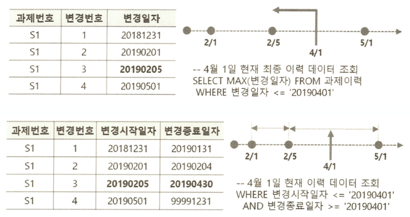

- **점 이력** — 값이 바뀐 시점을 기록한다. 4월 1일의 과제명을 찾으려면 해당 과제의 기록 중 변경일자가 4월 1일이거나 그보다 앞선 가장 최근 기록을 찾는다.
- **선분 이력** — 각 값이 유효한 시작일과 종료일을 기록한다. 4월 1일을 포함하는 기간을 찾으면 당시 과제명을 알 수 있다.

#### 최종 데이터 포함 vs 미포함

여기서 최종 데이터는 **현재 사용 중인 값**을 뜻한다. 과제명이 `질의형 검색`에서 `질의응답형 검색`으로 바뀌었다고 하자.

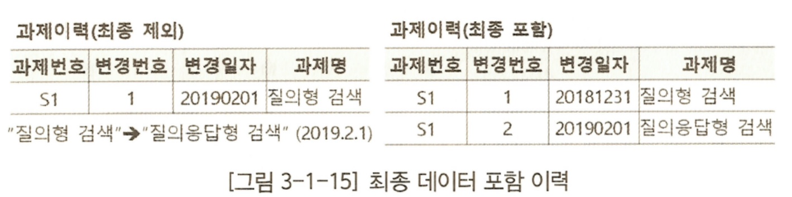

- **최종 데이터 미포함(왼쪽)** — 이력에는 이전 이름인 `질의형 검색`만 남긴다. 현재 이름인 `질의응답형 검색`은 과제 테이블에서 확인한다.
- **최종 데이터 포함(오른쪽)** — 이전 이름과 현재 이름을 모두 이력에 남긴다. 이력 테이블의 가장 최근 기록에서도 `질의응답형 검색`을 확인할 수 있다.

 

## 3. 엔티티 도출과 정의

### 엔티티 도출 및 식별

현행 데이터를 분석하여 엔티티로 구체화한다.

- 현업의 기능 및 요구사항을 정의하면서 엔티티를 도출 및 식별
- 현행 모델에서 불필요한 것을 식별하여 삭제
- 엔티티명, 관계, 속성명을 정리하고 현업과 인터뷰로 확정
- 엔티티 통합과 용어의 통일

(기존 데이터베이스 구조를 분석해 논리 모델을 파악하는 방법을 **리버스 모델링**(Reverse Modeling)이라고 한다.)

### 엔티티 정의

데이터 집합을 규정, 발생 규칙, 업무 규칙, 설명을 기술한다.

- 독립적인 엔티티는 주민번호, 상품번호와 같은 식별자 중심으로 정의
- 종속 엔티티는 엔티티간의 관계를 파악하여 집합 단위 or 데이터 발생 기준을 정의
- 엔티티를 정의하는 방법
  1. 엔티티 자체만으로 정의
  2. 엔티티에서 관리하는 속성 중심으로 파악하여 정의
  3. 다른 엔티티와의 관계를 바탕으로 정의

 

## 4. 엔티티 통합과 데이터 통합

### 엔티티 통합

- **일반화(Generalization)** — 여러 엔티티의 공통점을 찾아 상위 엔티티로 묶는다. 예를 들어 개인고객과 법인고객이 공통으로 갖는 고객번호와 고객명은 `고객`에서 관리한다.
- **특수화(Specialization)** — 상위 엔티티를 업무상 의미 있는 하위 유형으로 나눈다. 예를 들어 `고객`을 `개인고객`과 `법인고객`으로 구분하고, 법인등록번호는 `법인고객`에서 관리한다.

### 데이터 통합

데이터의 분류 체계, 식별 체계, 속성 체계를 일원화하는 과정

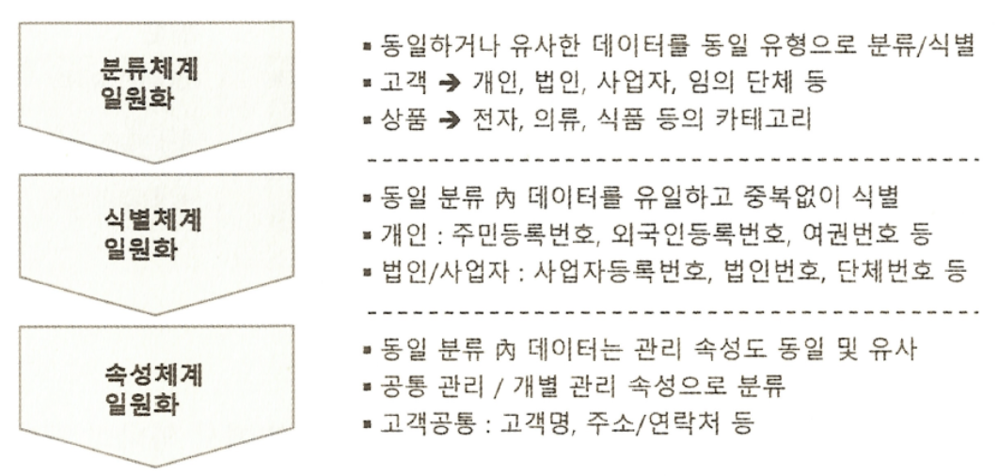

 

## 5. 관계, 속성, 식별자, 도메인 도출 및 정의

### ① 관계 도출 및 정의

관계를 도출할 때는 **두 엔티티가 업무에서 어떤 역할로 연결되는지** 확인한다. 엔티티 간의 관계에는 종속 관계, 참조 관계가 있다.

- 행위의 주체, 대상, 상세, 인과, 역할/자격, 구성, 참조 관계 등으로 구분
- 각 관계는 양방향으로 읽으면서 **몇 건까지 연결될 수 있는지(관계수)**, **반드시 연결되어야 하는지(선택성)**, **식별자 상속** 을 정한다. 역할을 구별할 필요가 있으면 관계명을 붙인다.

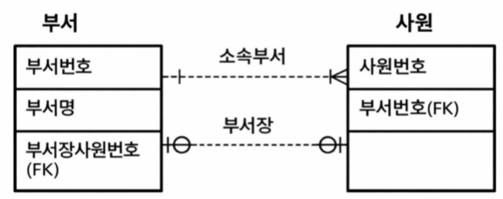

- **소속부서(위쪽 선)** — 한 사원의 소속을 알고 싶으면 `사원`에 기록된 `부서번호`로 해당 부서를 찾는다. 같은 부서번호를 가진 사원들을 모으면 그 부서의 구성원도 알 수 있다.
- **부서장(아래쪽 선)** — 한 부서의 부서장을 알고 싶으면 `부서`에 기록된 `부서장사원번호`로 해당 사원을 찾는다.

### ② 속성 도출 및 정의

속성을 도출할 때는 **해당 엔티티에 대해 무엇을 알아야 하는지** 살펴본다.

- 속성의 정의, 이름, 설명, 데이터 타입, 데이터 범위 등을 정의
- 속성이 만족해야 하는 조건이나 참조, 필수/선택 여부 등을 정의
- 속성의 이름은 이해하기 쉽게 자세히. 주제 영역 내에서 동일한 의미를 가져야 한다.
- 속성의 이름만으로 설명이 어렵다면, 별도의 설명으로 상세히 기술한다.

### ③ 식별자 지정

- **식별자**(Identifier)의 특성(유일성, 존재성, 불변성, 최소성)에 맞는 속성을 선택한다.
- 주 식별자는 반드시 값이 있어야 하며, 그 값의 조합은 각 건을 유일하게 구별해야 한다.

 

인조 식별자는 언제 고려할까?

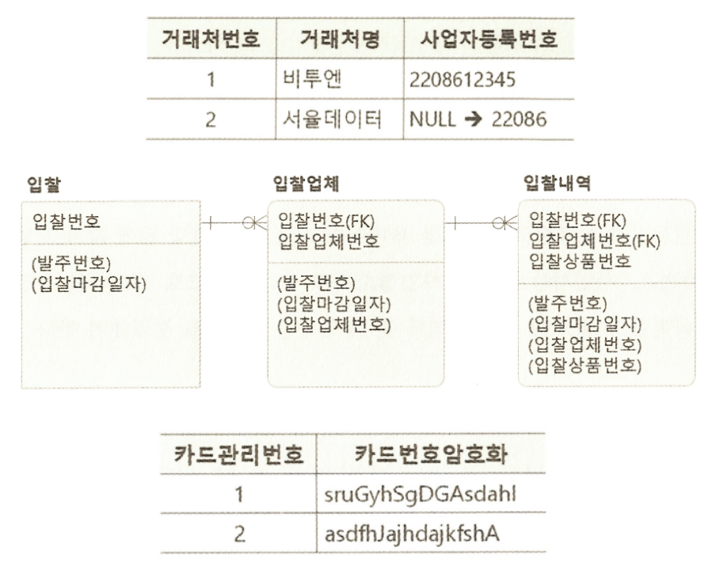

- **업무 절차상 먼저 등록해야 할 때** — 사업자등록번호를 나중에 입력하는 거래처도 있다. 등록 시점에 `거래처번호`를 부여하면 사업자등록번호가 없어도 거래처를 구별할 수 있다.
- **복합키를 단순화할 때** — 발주번호와 입찰마감일자의 조합으로 구별하던 입찰에 `입찰번호`를 부여한다. 그러면 `입찰업체`는 자신이 참여한 입찰을 `입찰번호` 하나로 참조할 수 있다.
- **암호화 대상 정보를 식별에 사용해야 할 때** — 카드번호는 암호화해 보관하고, 다른 데이터에서 카드를 참조할 때는 별도로 부여한 `카드관리번호`를 사용한다.
- 여러 엔티티를 통합할 때 모든 유형에 공통으로 쓸 식별자가 없다면, 통합 엔티티에 새 식별자를 부여할 수 있다.

### ④ 도메인 및 데이터 타입 지정

**도메인**(Domain)은 속성에 허용되는 값의 집합이다. 각 속성의 의미에 맞게 데이터 타입과, 범위, 조건을 지정한다.

- 값을 반드시 입력해야 하는지, 비워 둘 수 있는지 정한다.
- 속성에 맞는 타입과 길이를 일관되게 지정 (문자열의 경우 넉넉히)
- 입력값이 없을 때 사용될 default값 지정 (default 0에 의해 평균값이 달라질 수 있으니 주의)

 

## 6. 데이터 모델 검토

요구사항이 모두 반영되었는지 오류는 없는지 검토

- 자체 검토 - 체크 리스트 작성 및 확인.
- 동료 검토 - 타인과 질문 답변을 통한 제 3자 확인 검토
- 이해 관계자 리뷰 - 현업, 현업 운영자 등 관계자를 대상으로 설명 및 의견 반영
- 산출물을 통한 검토 - 요구사항 추적표(산출물) 등을 통한 검토

 

## 7. 데이터 표준화

**데이터 표준화**(Data Standardization)는 여러 업무에서 같은 의미의 데이터를 일관된 이름과 형식으로 사용하도록 기준을 정하는 일이다.

| 대상   | 정하는 내용                                                                   | 예시                                                      |
| ------ | ----------------------------------------------------------------------------- | --------------------------------------------------------- |
| 단어   | 이름을 구성하는 단어의 뜻과 표준 표기, 영문 약어를 정한다.                    | 고객 → `CUST`, 전화번호 → `TELNO`                         |
| 도메인 | 같은 성격의 속성에 적용할 데이터 타입·길이·허용값을 정한다.                   | ‘여부’는 한 자리 문자로 표현하고 `Y` 또는 `N`을 허용한다. |
| 코드   | 분류하려는 값을 목록으로 만들고 코드별 의미를 정한다.                         | 결재상태에서 `01`은 기안, `02`는 승인이다.                |
| 용어   | 표준 단어를 조합해 실제 속성의 한글명·영문명·정의를 정하고 도메인을 연결한다. | 고객전화번호 → `CUST_TELNO`, 전화번호 도메인 적용         |

 

표준화 예시

**단어·도메인·용어의 관계**

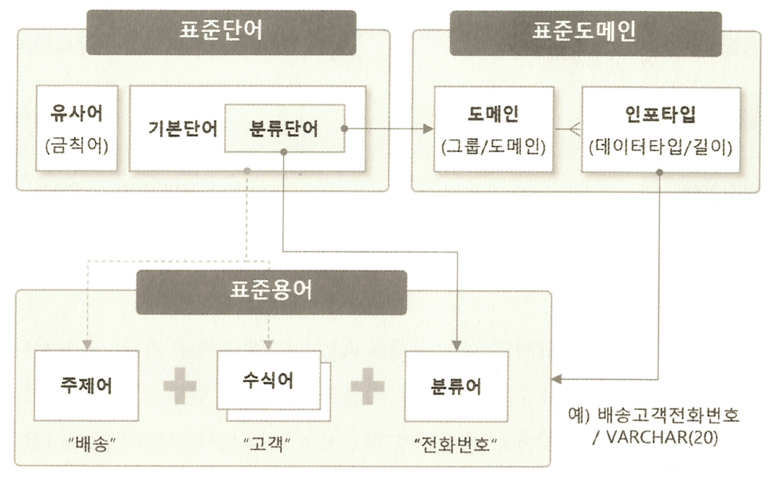

**① 단어 표준화**

단어사전에 대표 표기와 약어를 등록한다. 같은 뜻의 단어가 여러 개일 때 어떤 단어를 쓸지, 새 영문 약어는 어떻게 지을지도 정한다.

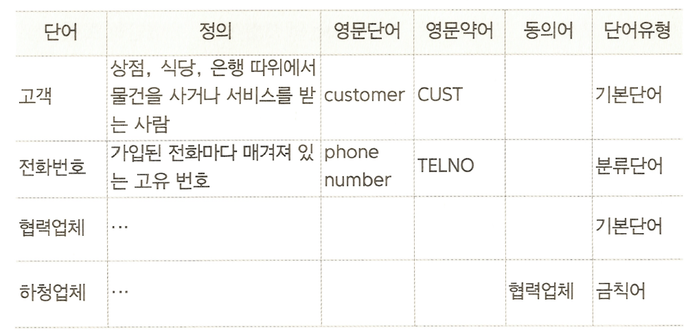

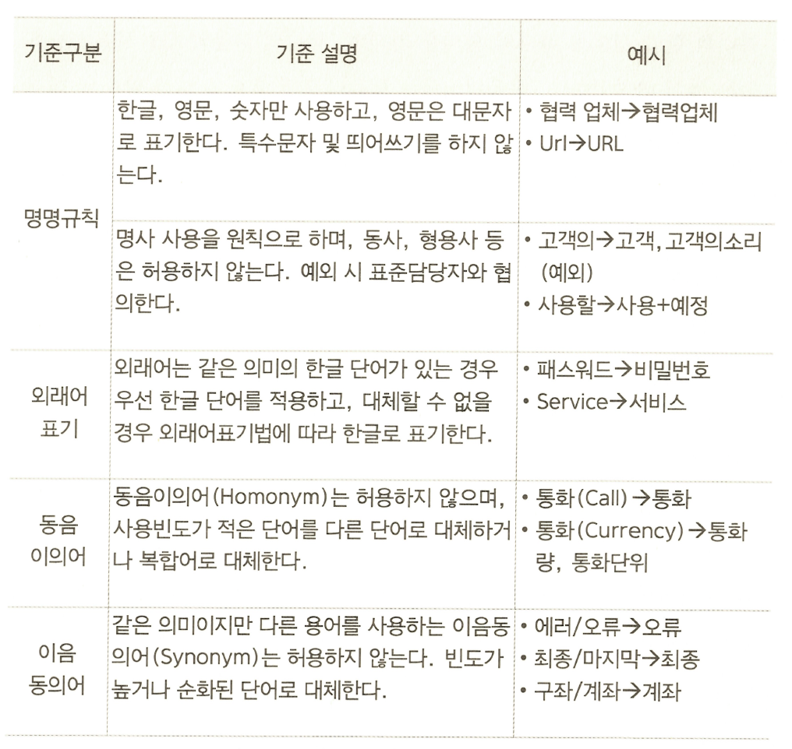

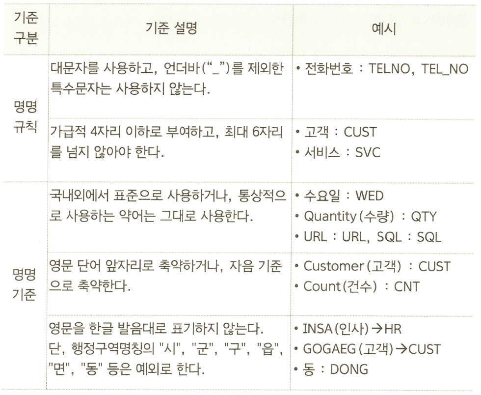

**② 도메인 표준화**

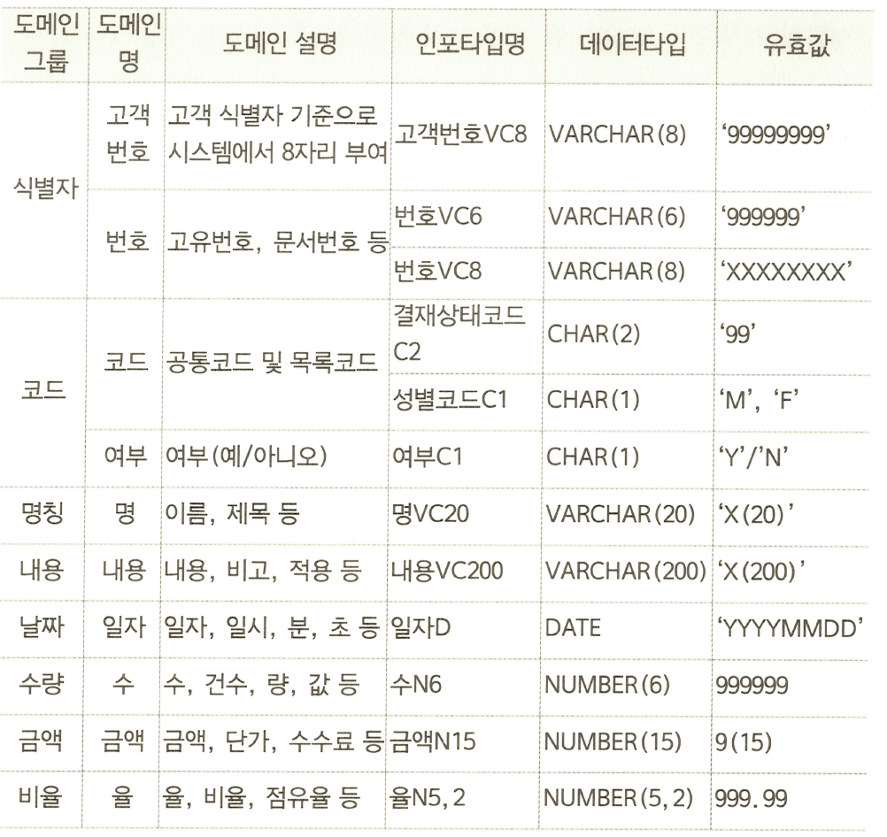

**③ 코드 표준화**

코드값은 코드 유형과 함께 읽는다. 아래 사전에서 같은 `01`도 결재상태에서는 ‘기안’, 결재수단에서는 ‘신용카드’를 뜻한다.

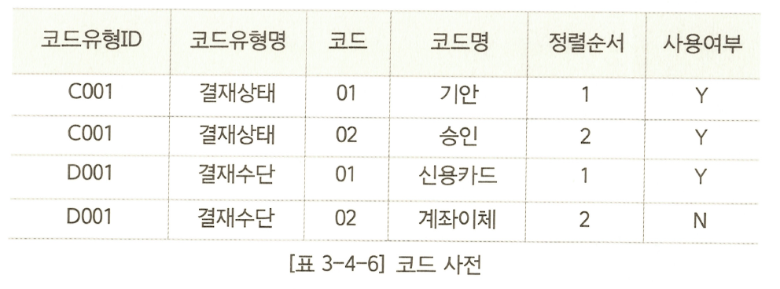

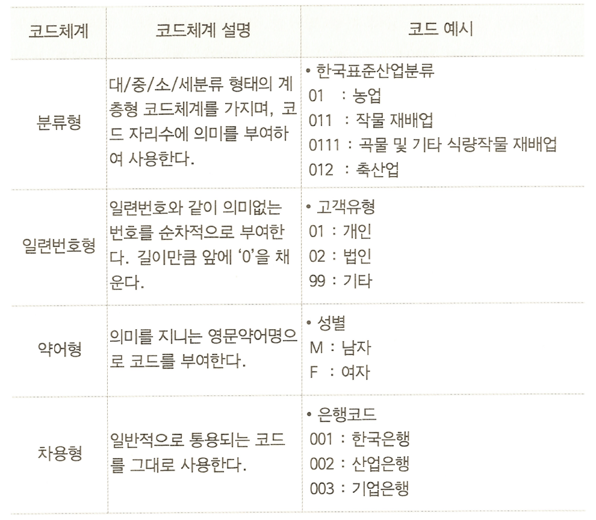

**④ 용어 표준화**

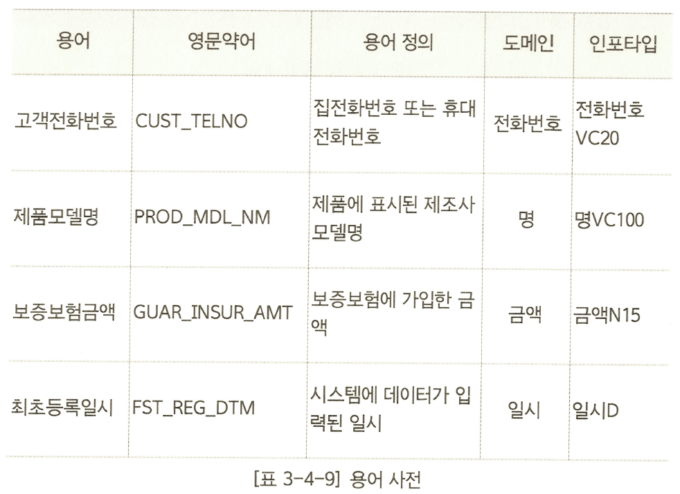

 

### 참고 자료

핵심 데이터 모델링
