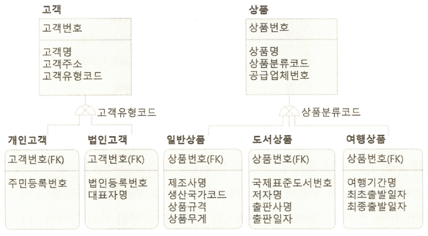

# 3장. 논리 모델링 — 업무 규칙을 데이터 구조로 표현하기

논리 모델링(Logical Data Modeling)은 개념 모델의 핵심 엔티티를 출발점으로 **한 건의 의미, 식별자, 속성, 관계, 허용값**을 구체화하는 단계다. 업무 규칙은 상세히 정하되 특정 DBMS의 저장 방식은 물리 설계에서 결정한다.

## 1. 핵심 엔티티에서 상세·상태·이력으로 확장하기

핵심 엔티티를 정의할 때는 이름과 함께 **어떤 대상이 언제 한 건으로 등록되는지** 적는다. ‘고객’이라면 비회원도 포함하는지에 따라 데이터의 범위가 달라진다. 유형·분류, 업무 규칙, 주체·대상, 장소도 업무에서 따로 관리하면 엔티티 후보가 된다.

*수업 PPT 46쪽. 품의 한 건에 항목이 여러 개면 품의내역에 한 줄씩 기록한다. 거래처와의 연결에 계약금액이 붙으면 그 금액은 품의거래처에서 관리한다.*

**이력(History)**은 과거 시점의 값을 다시 알아야 할 때 관리한다. 먼저 이력을 남길 속성과 현재값의 저장 위치를 정한다. 현재값을 별도로 보관한다면 이력과 함께 갱신하는 규칙도 필요하다.

*수업 PPT 47쪽. 4월 1일의 상태를 찾을 때, 점 이력은 그날까지의 마지막 변경(2월 5일)을 찾고, 선분 이력은 그날이 들어가는 기간(2월 5일~4월 30일)을 찾는다. 선분 이력은 같은 대상의 유효기간이 겹치지 않게 관리해야 한다.*

## 2. 엔티티 통합과 관계 정의

*수업 PPT 50쪽. 공통 속성을 상위 유형에 모으는 과정이 일반화(Generalization), 유형별 특성을 하위 유형으로 구체화하는 과정이 특수화(Specialization)다.*

엔티티를 통합할 때는 이름뿐 아니라 **분류 기준·식별 기준·속성의 의미**도 맞춰야 한다. 관계는 양쪽에서 읽으며 최대 몇 건까지 연결되는지(관계수), 연결이 필수인지(선택성), 부모 식별자가 자식의 식별자에 포함되는지(식별 관계)를 각각 결정한다.

## 3. 식별자·속성·도메인 결정하기

**수강신청 실습에 적용한 예시** — 한 건을 ‘학생이 특정 훈련과정에 제출한 신청 한 번’으로 정의한 경우다.

| 설계 항목 | 결정과 이유 |
| --- | --- |
| 식별자(Identifier) | 신청ID로 각 신청을 구별한다. 같은 학생의 같은 과정 재신청을 허용할지는 별도 업무 규칙이다. 인조 식별자만으로는 중복 신청을 막을 수 없다. |
| 관계(Relationship) | 신청 한 건에는 학생 한 명이 필요하고, 학생에게는 아직 신청이 없을 수 있다. |
| 속성(Attribute) | 신청일시는 제출 시점에 필수다. 승인일시를 관리한다면 접수 단계에서는 값이 없을 수 있다. |
| 도메인(Domain) | 신청상태의 허용값을 예컨대 ‘접수·승인·반려’로 정한다. 기본값은 실제 의미가 있을 때 정한다. 미입력 점수를 0으로 기록하면 평균 계산에 포함된다. |

식별자 후보는 **유일성·최소성·존재성·안정성**을 확인한다. 속성에는 뜻, 필수 여부, 값의 범위와 단위를 기록한다.

## 4. 표준화하고 요구사항과 대조하기

| 표준화 대상 | 무엇을 통일하는가 | 예시 |
| --- | --- | --- |
| 단어·영문 약어 | 같은 개념의 표기 | ‘신청’을 한 가지 표준 단어로 사용 |
| 용어 | 단어를 조합한 명칭과 정의 | ‘신청일시’는 신청을 제출한 시각 |
| 도메인 | 공통으로 적용할 값의 형식과 범위 | 일자와 일시를 구분 |
| 코드 | 허용값, 코드의 의미와 부여 방식 | 접수·승인·반려에 일관된 상태코드 부여 |

마지막으로 요구사항 한 줄을 실제 모델에서 따라가 본다. ‘지난달 말의 신청상태를 조회한다’는 요구가 있다면 현재 상태만으로는 답할 수 없다. 이처럼 자체 검토와 동료 검토로 빠진 구조를 찾고, 해석이 갈리는 업무 규칙은 현업 담당자와 확인한다.

수업 자료 — 『DB모델링 all PPT』 PDF 43~64쪽. 수강신청 정책과 표준화 예시는 설명을 위한 가정이다.
