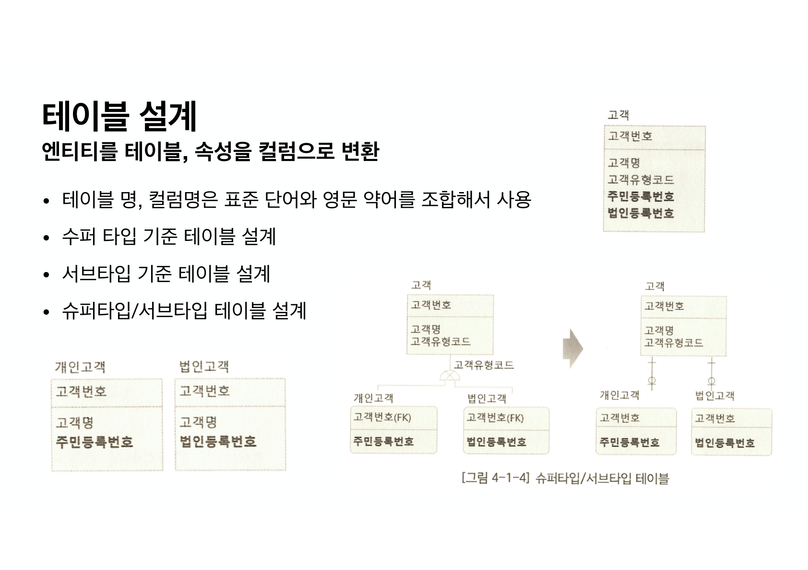
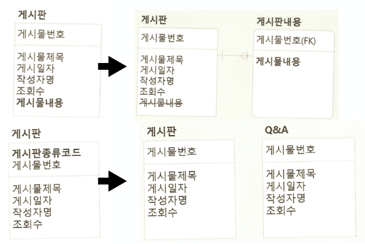

# 4장. 물리 모델링 — 논리 모델을 테이블로 구현하기

1. [테이블 설계](#1-테이블-설계)
2. [관계 설계](#2-관계-설계)
3. [컬럼 설계](#3-컬럼-설계)
4. [성능을 고려한 데이터 구조](#4-성능을-고려한-데이터-구조)

 

**물리 모델링**(Physical Data Modeling)은 논리 모델을 사용할 DBMS에 맞게 테이블·컬럼·키·제약조건으로 구체화하는 단계다. 업무 규칙을 데이터베이스에서 지킬 수 있도록 설계하고, 자주 발생하는 조회와 변경 작업을 고려해 데이터의 저장 구조를 정한다.

 

## 1. 테이블 설계

엔티티는 테이블로, 속성은 컬럼으로, 주 식별자는 기본키(PK)로 변환한다. 테이블명과 컬럼명은 논리 모델링에서 정한 표준 단어와 영문 약어를 사용해 일관되게 짓는다.

슈퍼타입과 서브타입을 테이블로 옮길 때는 **공통 정보와 유형별 정보를 어디에 저장할지** 결정한다. 예를 들어 개인고객과 법인고객은 고객번호·고객명을 공통으로 사용하지만, 법인등록번호는 법인고객에게만 필요하다.

| 설계 방식           | 고객 예시                                                                         | 고려할 점                                                                                   |
| ------------------- | --------------------------------------------------------------------------------- | ------------------------------------------------------------------------------------------- |
| 슈퍼타입 기준       | `고객` 테이블 하나에 공통 컬럼과 유형별 컬럼을 모두 두고 고객유형코드로 구분한다. | 전체 고객을 한 번에 조회하기 쉽다. 유형별로 어떤 컬럼이 필수인지 정해야 한다.               |
| 서브타입 기준       | `개인고객`과 `법인고객` 테이블을 따로 만들고, 고객번호·고객명도 각 테이블에 둔다. | 유형별 업무를 처리하기 쉽다. 전체 고객 목록을 보려면 두 테이블의 결과를 합쳐야 한다.        |
| 슈퍼타입 + 서브타입 | `고객`에는 공통 정보, `개인고객`과 `법인고객`에는 유형별 정보를 둔다.             | 공통 정보는 한 곳에서 관리한다. 고객명과 법인등록번호를 함께 읽으려면 두 테이블을 조인한다. |

세 번째 방식에서 `법인고객.고객번호`는 법인고객 한 건을 구별하는 **기본키(PK)**이면서, 같은 고객의 공통 정보를 가리키는 **외래키(FK)**다.

 

## 2. 관계 설계

논리 모델에서 정의한 관계를 테이블에 옮길 때는 **어느 테이블에 참조 컬럼을 두고, 어떤 데이터와 연결할지** 정한다.

- **기본 관계** — 1:N 관계에서는 보통 N쪽에 외래키를 둔다. 고객 한 명이 여러 주문을 할 수 있다면 `주문.고객번호`가 `고객.고객번호`를 참조한다. 모든 주문에 고객이 반드시 있어야 한다면 `NOT NULL`도 지정한다. 외래키는 입력한 고객번호가 실제로 존재하는지 확인하고, `NOT NULL`은 고객번호를 비워 두는 것을 막는다.
- **재귀 관계** — 같은 테이블 안의 다른 행을 참조해 계층을 표현한다. 예를 들어 산업분류 테이블의 `상위산업분류코드`는 같은 테이블의 `산업분류코드`를 참조한다. 최상위 분류는 상위 코드가 없으므로 값을 비워 둘 수 있다.
- **상호배타적 관계** — 여러 참조 대상 중 최대 하나만 선택할 수 있는 관계다. 예를 들어 모든 계좌에 소유자가 반드시 한 명 또는 한 곳 있어야 하고, 그 유형이 개인·법인·단체 중 하나라면 다음 두 방식으로 설계할 수 있다.

| 설계 방식      | 계좌 테이블에서 표현하는 방법                                                   | 고려할 점                                                                                                                  |
| -------------- | ------------------------------------------------------------------------------- | -------------------------------------------------------------------------------------------------------------------------- |
| 참조 컬럼 통합 | `고객유형코드`로 소유자 유형을 구분하고 `고객번호` 하나에 해당 번호를 저장한다. | 개인·법인·단체가 별도 테이블이면 외래키 하나로 유형에 따라 참조 대상을 바꿀 수 없어, 번호의 유효성을 별도로 보장해야 한다. |
| 참조 컬럼 분리 | `개인번호`, `법인번호`, `단체번호`를 각각 해당 테이블의 외래키로 둔다.          | 외래키는 입력한 번호가 실제로 존재하는지 확인한다. 세 컬럼 중 정확히 하나에만 값이 들어가도록 `CHECK` 제약조건을 둔다.     |

 

## 3. 컬럼 설계

논리 모델의 속성을 컬럼으로 옮기면서 표준 용어와 도메인을 적용한다. 컬럼마다 대상 DBMS에서 사용할 **데이터 타입·길이·필수 여부·기본값**을 정한다.

| 설계할 때 확인할 점    | 예시                                                                                                                                                                                                                                                                           |
| ---------------------- | ------------------------------------------------------------------------------------------------------------------------------------------------------------------------------------------------------------------------------------------------------------------------------ |
| 고정 길이 vs 가변 길이 | 한 자리 여부 코드처럼 길이가 일정하면 `CHAR`, 고객명처럼 길이가 달라지면 가변 길이 문자 타입을 검토한다. Oracle에서는 `VARCHAR2`를 사용한다.                                                                                                                                   |
| 날짜 타입 vs 문자 타입 | 날짜 계산이나 유효성 검사가 중요하면 `DATE`를, 더 정밀한 시각까지 필요하면 `TIMESTAMP`를 사용한다. 외부 시스템에서 받은 `YYYYMMDD` 형식의 8자리 값을 그대로 보관해야 한다면 `VARCHAR2(8)`도 고려한다. 이 경우 `20260230`처럼 실제로 존재하지 않는 날짜는 별도로 검증해야 한다. |
| 유니코드 지원 여부     | 한글이나 여러 언어를 저장한다면 문자 집합과 컬럼의 문자 타입을 확인한다. Oracle에서는 데이터베이스 문자 집합에 따라 `VARCHAR2`로도 유니코드를 저장할 수 있다. 길이를 바이트 기준으로 지정할지, 문자 수 기준으로 지정할지도 확인한다.                                           |

업무 속성 외에 **등록·수정 정보를 추적하는 시스템 컬럼**을 둘 수 있다. 대표적으로 `최초등록일시`, `최초등록자식별번호`, `최종수정일시`, `최종수정자식별번호`를 사용한다. 이 네 컬럼으로 누가 언제 등록하고 마지막으로 수정했는지 확인할 수 있다.

 

## 4. 성능을 고려한 데이터 구조

성능을 위해 구조를 바꿀 때는 먼저 **어떤 조회나 변경이 자주 발생하고 어디에서 비용이 드는지** 확인한다. 대표적인 방법으로 집계·요약 테이블 추가, 역정규화, 테이블 분할이 있다.

### 집계·요약 테이블과 중복 컬럼

- **집계·요약 테이블** — 방문이력을 매번 집계하는 비용이 크다면 회원별 방문횟수를 미리 계산해 별도 테이블에 저장할 수 있다. 방문 직후의 횟수가 필요하면 실시간으로, 전날까지의 통계면 충분하면 배치로 갱신한다.
- **역정규화와 중복 컬럼** — 주문내역을 주문일자와 함께 자주 조회한다면 `주문`에 있는 주문일자를 `주문내역`에도 저장해 조인을 줄일 수 있다. 이 경우 원본 주문일자가 바뀔 때 중복 저장한 값도 일치하도록 관리해야 한다.

### 수직 분할과 수평 분할

- **수직 분할(컬럼 기준)** — 그림 위쪽처럼 게시물 제목·작성자 등 목록에 필요한 컬럼과 긴 본문을 별도 테이블로 나눈다. 목록은 본문을 읽지 않고 조회하고, 상세 화면에서는 게시물번호로 본문을 연결한다.
- **수평 분할(행 기준)** — 그림 아래쪽처럼 같은 구조의 게시물을 일반 게시판과 Q&A 게시판으로 나눈다. 한 게시판만 조회할 때는 해당 데이터만 읽을 수 있고, 전체 게시물을 조회할 때는 나눈 결과를 다시 합쳐야 한다.

 
