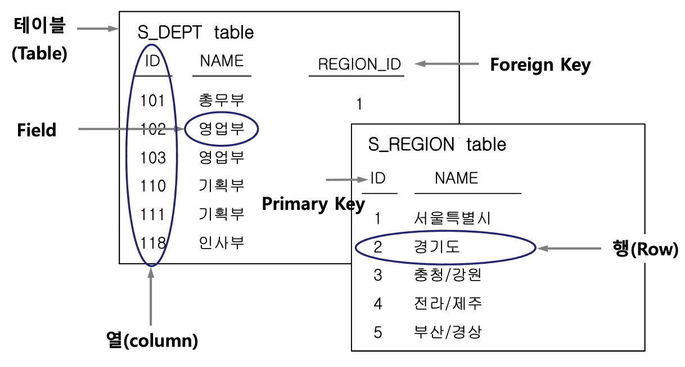

# SQL 기초: 관계형 데이터베이스의 개념과 특징

## 목차

1. [관계형 데이터베이스(RDB)와 RDBMS](#1-관계형-데이터베이스rdb와-rdbms)
2. [데이터 무결성(Data Integrity)](#2-데이터-무결성data-integrity)
3. [데이터베이스 기본 용어](#3-데이터베이스-기본-용어)
4. [SQL, SQL\*Plus, PL/SQL](#4-sql-sqlplus-plsql)
5. [Oracle 기본 계정과 사용자 계정 생성](#5-oracle-기본-계정과-사용자-계정-생성)
6. [권한(Privilege)과 역할(Role)](#6-권한privilege과-역할role)

<br>

## 1. 관계형 데이터베이스(RDB)와 RDBMS

### 개념

- **관계형 데이터베이스(RDB)**: 데이터를 행(Row)과 열(Column)로 이루어진 2차원 테이블에 저장하고, 여러 테이블을 서로 연결해 관리하는 데이터베이스의 한 종류이다.
- **RDBMS**: 이런 관계형 데이터베이스를 만들고 관리할 수 있게 해 주는 소프트웨어다. Oracle Database, MySQL, PostgreSQL 등이 있다.

### 특징

- 데이터를 **테이블** 단위로 정리한다. 행은 데이터 한 건이고, 열은 데이터의 속성이다.
- **PK(기본키)**로 행을 구별하고, **FK(외래키)**로 테이블 사이의 관계를 표현할 수 있다.
- **제약조건**을 이용해 잘못된 데이터가 들어오거나 참조 관계가 깨지는 것을 막는다.
- **SQL**로 데이터를 조회하거나 추가·수정·삭제한다.

<br>

## 2. 데이터 무결성(Data Integrity)

**데이터 무결성**은 데이터가 잘못 저장되거나 서로 모순되지 않도록 정확성과 일관성을 유지하는 것이다. 데이터베이스에서는 주로 **제약조건(Constraint)**을 통해 이를 지킨다.

### 주요 제약조건

| 제약조건      | 역할                                                                |
| ------------- | ------------------------------------------------------------------- |
| `NOT NULL`    | 값이 반드시 있어야 하는 컬럼에 `NULL`이 들어가지 못하게 한다.       |
| `UNIQUE`      | 같은 값이 중복되지 않도록 한다.                                     |
| `PRIMARY KEY` | 각 행을 식별하며, 중복과 `NULL`을 허용하지 않는다.                  |
| `FOREIGN KEY` | 다른 테이블 등을 참조할 때 존재하지 않는 값을 가리키지 못하게 한다. |
| `CHECK`       | 정해 놓은 조건에 맞는 값만 저장하도록 제한한다.                     |

**예시:** 직원의 `DEPT_ID`가 부서 테이블의 `ID`를 참조하도록 FK를 설정하면, 없는 부서 번호를 입력하는 실수를 막을 수 있다.

<br>

## 3. 데이터베이스 기본 용어



| 용어             | 설명                                                   |
| ---------------- | ------------------------------------------------------ |
| Table            | 관련 데이터를 모아 놓은 표                             |
| Row              | 데이터 한 건(레코드)                                   |
| Column           | 데이터의 속성(예: 이름, 급여)                          |
| Field            | 행과 열이 만나는 한 칸의 값                            |
| Schema           | Oracle에서 한 사용자에게 속한 테이블 등 DB 객체의 집합 |
| Primary Key (PK) | 행을 고유하게 구별하는 키                              |
| Foreign Key (FK) | 다른 테이블 또는 같은 테이블의 키를 참조하는 키        |

### PK와 FK의 차이

- **PK**는 **이 행이 누구인지 구별하는 기준**이다. 중복과 `NULL`을 허용하지 않으며, 여러 컬럼을 묶어 하나의 복합키로 만들 수도 있다. (`NOT NULL`, `UNIQUE`)
- **FK**는 **이 데이터가 어디와 연결되는지 나타내는 기준**이다. 참조 대상은 PK 또는 UNIQUE 키여야 하며, 별도의 `NOT NULL` 제약조건이 없다면 `NULL`을 허용할 수 있다.

**예시**

- `S_DEPT.ID`: 부서를 구별하는 기본키
- `S_EMP.DEPT_ID`: 직원이 어느 부서에 속하는지를 나타내며, `S_DEPT.ID`를 참조하는 외래키로 설정할 수 있는 컬럼

<br>

## 4. SQL, SQL\*Plus, PL/SQL

| 구분      | 설명                                                                                      |
| --------- | ----------------------------------------------------------------------------------------- |
| SQL       | 데이터베이스에 조회·추가·수정·삭제 같은 작업을 요청하는 언어                              |
| SQL\*Plus | Oracle에서 SQL과 PL/SQL을 입력하고 실행하는 명령줄 도구                                   |
| PL/SQL    | SQL에 변수, 조건문, 반복문 등을 더해 여러 작업을 하나의 프로그램처럼 처리하는 Oracle 언어 |

<br>

## 5. Oracle 기본 계정과 사용자 계정 생성

### 기본 계정

| 계정          | 역할                                                                |
| ------------- | ------------------------------------------------------------------- |
| `SYS`         | 데이터 딕셔너리 등을 소유하는 핵심 관리자 계정                      |
| `SYSTEM`      | 일반적인 데이터베이스 관리 작업을 위한 관리자 계정                  |
| `SCOTT`, `HR` | SQL 학습에 사용되는 예제 계정·스키마(설치 환경에 따라 없을 수 있음) |

`SYS`, `SYSTEM`은 관리 작업에 사용하고, 실습이나 애플리케이션 데이터는 별도 사용자 계정에서 다루는 것이 좋다.

### TABLESPACE와 TEMPORARY TABLESPACE

**테이블스페이스(Tablespace)** 는 Oracle이 데이터를 저장 공간별로 관리하기 위해 사용하는 **논리적인 공간**이다. 영구 테이블스페이스는 실제 데이터 파일(Datafile)과 연결된다.

| 구분                | 역할                                                | 예시    |
| ------------------- | --------------------------------------------------- | ------- |
| 영구 테이블스페이스 | 테이블·인덱스처럼 계속 보관할 데이터 저장           | `USERS` |
| 임시 테이블스페이스 | 정렬·해시 조인 등 SQL 처리 중 필요한 임시 공간 제공 | `TEMP`  |

- `DEFAULT TABLESPACE`: 사용자가 테이블 같은 객체를 만들 때 기본으로 저장할 공간을 지정한다.
- `TEMPORARY TABLESPACE`: SQL 실행 중 임시 공간이 필요할 때 사용할 곳을 지정한다.
- `QUOTA`: 특정 **영구** 테이블스페이스를 얼마나 사용할 수 있는지 정한다.

### 사용자 계정 생성

```sql
CREATE USER student
IDENTIFIED BY 1234
DEFAULT TABLESPACE USERS
TEMPORARY TABLESPACE TEMP
QUOTA 100M ON USERS;
```

위 SQL은 `student`라는 사용자를 만들고, 기본 저장 공간과 임시 작업 공간을 지정하는 예시다. **계정만 생성했다고 곧바로 로그인할 수 있는 것은 아니다.** 접속하려면 `CREATE SESSION` 권한이 필요하다.

<br>

## 6. 권한(Privilege)과 역할(Role)

- **권한(Privilege)**: 사용자가 데이터베이스에서 특정 작업을 수행할 수 있도록 권한을 부여하는 것이다.
- **역할(Role)**: 여러 권한을 한데 묶어 사용자에게 부여하기 쉽게 만든 것이다.

### 권한의 종류

| 구분        | 설명                                                   | 예시                                            |
| ----------- | ------------------------------------------------------ | ----------------------------------------------- |
| 시스템 권한 | DB에서 특정 작업을 수행할 수 있는 권한                 | `CREATE SESSION`, `CREATE TABLE`, `CREATE VIEW` |
| 객체 권한   | 특정 테이블 같은 객체를 사용하거나 변경할 수 있는 권한 | `SELECT`, `INSERT`, `UPDATE`, `DELETE`          |

**자주 쓰는 시스템 권한**

- `CREATE SESSION`: DB에 접속
- `CREATE TABLE`, `CREATE VIEW`: 테이블·뷰 생성
- `CREATE ROLE`: 역할 생성
- `ALTER USER`, `DROP USER`: 사용자 변경·삭제

### GRANT와 REVOKE

`GRANT`는 권한을 주는 명령어이고, `REVOKE`는 부여한 권한을 회수하는 명령어다.

```sql
-- 새 사용자는 접속 권한이 없으므로 별도로 부여해야 한다.
GRANT CREATE SESSION, CREATE TABLE TO student;

-- 테이블 생성 권한 회수
REVOKE CREATE TABLE FROM student;

-- 다른 사용자(practice_user)에게 STUDENT의 테이블 조회 권한 부여
GRANT SELECT ON student.s_emp TO practice_user;
```

- `WITH ADMIN OPTION`: 받은 **시스템 권한이나 역할**을 다른 사용자에게도 부여할 수 있도록 허용한다.
- `WITH GRANT OPTION`: 받은 **객체 권한**을 다른 사용자에게도 부여할 수 있도록 허용한다.

### CONNECT와 RESOURCE

```sql
GRANT CONNECT, RESOURCE TO student;
```

- `CONNECT`: 데이터베이스에 접속할 수 있는 `CREATE SESSION` 권한을 포함하는 기본 역할이다.
- `RESOURCE`: 테이블 등 여러 DB 객체를 생성하기 위한 권한을 묶은 역할이다.

<br>

## 참고 자료

- 『SQL의 정석』 0~1장
