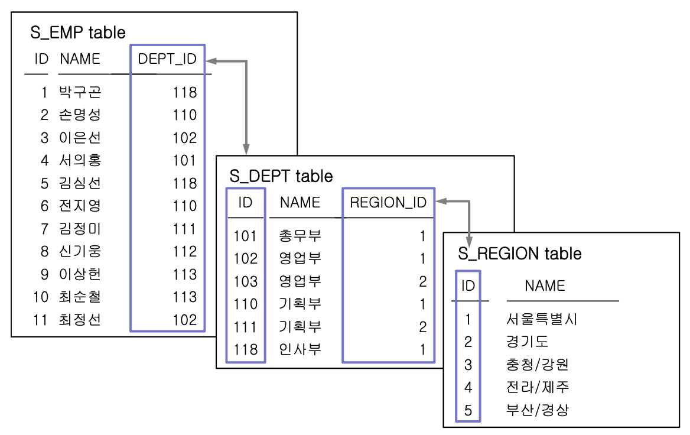
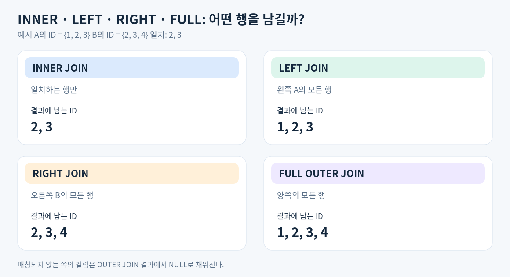
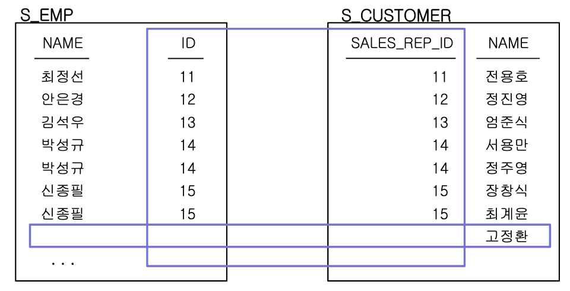
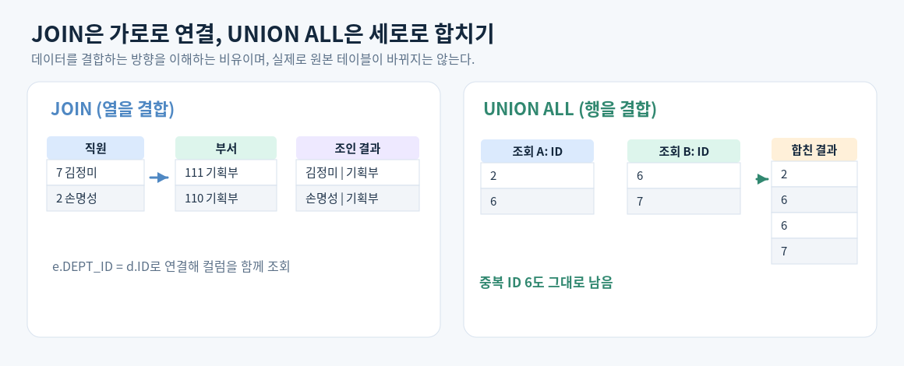

# SQL 기초: 조인(JOIN)과 집합 연산자(SET)

## 목차

1. [JOIN의 개념과 테이블 연결 관계](#1-join의-개념과-테이블-연결-관계)
2. [EQUI JOIN: 같은 값으로 연결](#2-equi-join-같은-값으로-연결)
3. [NON-EQUI JOIN: 범위 조건으로 연결](#3-non-equi-join-범위-조건으로-연결)
4. [INNER JOIN: 일치하는 행만 조회](#4-inner-join-일치하는-행만-조회)
5. [OUTER JOIN: 일치하지 않는 행도 조회](#5-outer-join-일치하지-않는-행도-조회)
6. [SELF JOIN: 같은 테이블을 서로 다른 역할로 연결](#6-self-join-같은-테이블을-서로-다른-역할로-연결)
7. [그 밖의 조인과 주의할 점](#7-그-밖의-조인과-주의할-점)
8. [SET 연산자](#8-set-연산자-select-결과를-세로로-결합)

<br>

## 1. JOIN의 개념과 테이블 연결 관계

**JOIN(조인)**은 두 개 이상의 테이블에서 **서로 연관된 행을 찾아 하나의 조회 결과로 결합하는 방법**이다.

정보를 여러 테이블에 나누어 저장하더라도, 조인하면 필요한 데이터를 함께 조회할 수 있다.



| 연결할 테이블         | 연결 조건                        | 의미                      |
| --------------------- | -------------------------------- | ------------------------- |
| `S_EMP` ↔ `S_DEPT`    | `S_EMP.DEPT_ID = S_DEPT.ID`      | 직원이 소속된 부서를 연결 |
| `S_DEPT` ↔ `S_REGION` | `S_DEPT.REGION_ID = S_REGION.ID` | 부서가 속한 지역을 연결   |

그림에서 직원 **김정미**의 `DEPT_ID`는 `111`이다. `S_DEPT`의 `ID = 111`을 찾아보면 부서명은 `기획부`, `REGION_ID`는 `2`다. 다시 `S_REGION`의 `ID = 2`를 확인하면 지역명은 `경기도`다. 이렇게 **값이 대응되는 컬럼을 기준으로 행을 연결**한다.

이때 `S_DEPT`에는 같은 이름의 `기획부`가 여러 지역에 있을 수 있다. 따라서 부서 이름이 아니라 **직원의 `DEPT_ID`와 부서의 `ID`**를 연결해야 원하는 부서를 정확하게 찾을 수 있다.

조인은 일반적으로 PK(기본 키)와 FK(외래 키) 관계를 이용하지만, 실제로 FK 제약조건이 선언되어 있지 않더라도 연결 기준이 되는 값이 있다면 수행할 수 있다.

또한 조인은 **원본 테이블을 합쳐서 저장하는 작업이 아니라 조회 결과를 만드는 연산**이다.

### JOIN의 기준과 종류

- **연결 조건 기준:** 값이 같은지 비교하는 `EQUI JOIN`, 범위 등으로 비교하는 `NON-EQUI JOIN`
- **결과에 남기는 행 기준:** 일치하는 행만 남기는 `INNER JOIN`, 일치하지 않는 행도 남기는 `OUTER JOIN`
- **테이블 사용 방식:** 같은 테이블을 두 번 참조하는 `SELF JOIN` 등

서로 다른 기준이므로 **EQUI JOIN과 INNER JOIN은 대립하는 개념이 아니다.** 예를 들어 `=` 조건을 사용하면서 일치하는 행만 반환하는 조인은 *EQUI JOIN이면서 INNER JOIN*이다.

<br>

## 2. EQUI JOIN: 같은 값으로 연결

**EQUI JOIN(등가 조인)**은 두 테이블의 컬럼 값을 **`=` 연산자로 비교하여 일치하는 행을 연결**하는 조인이다.

```sql
SELECT e.ID,
       e.NAME AS EMP_NAME,
       e.DEPT_ID,
       d.NAME AS DEPT_NAME
FROM S_EMP e, S_DEPT d
WHERE e.DEPT_ID = d.ID
  AND e.ID IN (1, 2, 7)
ORDER BY e.ID;
```

**결과**

| ID  | EMP_NAME | DEPT_ID | DEPT_NAME |
| --- | -------- | ------- | --------- |
| 1   | 박구곤   | 118     | 인사부    |
| 2   | 손명성   | 110     | 기획부    |
| 7   | 김정미   | 111     | 기획부    |

- `FROM S_EMP e, S_DEPT d`: 직원 테이블과 부서 테이블을 조회 대상으로 지정한다.
- `e.DEPT_ID = d.ID`: 두 테이블의 **연결 조건**이다.
- `e.ID IN (1, 2, 7)`: 연결된 결과 중 직원 번호가 1, 2, 7인 행만 고르는 **조회 조건**이다.

`e`, `d`는 **테이블 별칭(ALIAS)**이다. `S_EMP`와 `S_DEPT`에 모두 `NAME` 컬럼이 있으므로 `e.NAME`, `d.NAME`처럼 구별해서 작성해야 한다. 컬럼 별칭(`AS EMP_NAME`)은 결과에 표시되는 제목을 바꾸는 용도다.

여기서 중요한 점은 `WHERE`가 일반적으로 행을 필터링하는 절이지만, **이전 방식의 조인 문법에서는 테이블을 연결하는 조건도 `WHERE`에 작성한다**는 것이다.

<br>

## 3. NON-EQUI JOIN: 범위 조건으로 연결

**NON-EQUI JOIN(비등가 조인)**은 두 테이블을 `=`이 아닌 비교 조건으로 연결하는 조인이다. 대표적으로 **`BETWEEN`, `<`, `>`** 등을 사용한다.

직원의 급여에 따라 등급을 알아보려면 `S_EMP.SALARY`와 `SALGRADE`의 급여 구간(`LOSAL`~`HISAL`)을 비교해야 한다. 급여와 등급 컬럼의 값이 같은 것은 아니므로 `=` 대신 범위 조건을 사용한다.

```sql
SELECT e.NAME,
       e.SALARY,
       g.GRADE
FROM S_EMP e, SALGRADE g
WHERE e.SALARY BETWEEN g.LOSAL AND g.HISAL
  AND e.ID IN (1, 2, 6, 17)
ORDER BY e.ID;
```

**결과**

| NAME   | SALARY | GRADE |
| ------ | -----: | ----- |
| 박구곤 |   5000 | A     |
| 손명성 |   3000 | B     |
| 전지영 |   2400 | C     |
| 구원상 |    940 | E     |

`SALGRADE`에서 각 등급은 급여 범위로 정의되어 있다. 예를 들어 A등급은 4000~5999, B등급은 3000~3999이며, `BETWEEN`은 양 끝값을 포함한다.

**EQUI JOIN은 `=` 조건, NON-EQUI JOIN은 그 외의 비교 조건**이라는 점이 핵심이다. 둘 다 조건에 맞는 행만 반환하므로 결과의 성격은 `INNER JOIN`이다. 급여가 `0`인 직원처럼 등급표의 어느 범위에도 속하지 않는 행은 이 조회 결과에 포함되지 않는다.

<br>

## 4. INNER JOIN: 일치하는 행만 조회

**INNER JOIN(내부 조인)**은 연결 조건에 **일치하는 행만 조회 결과로 반환**한다. 앞에서 배운 EQUI/NON-EQUI가 *연결 조건의 종류*라면, INNER JOIN은 *어떤 행을 남기는지*에 관한 개념이다.

지금까지는 `FROM 테이블1, 테이블2 WHERE 연결조건`으로 작성했지만, 연결 조건을 더 분명하게 표현하는 **`JOIN ... ON` 문법**을 사용할 수도 있다.

### JOIN ... ON으로 EQUI JOIN 작성하기

```sql
SELECT e.ID,
       e.NAME AS EMP_NAME,
       d.NAME AS DEPT_NAME
FROM S_EMP e
INNER JOIN S_DEPT d
    ON e.DEPT_ID = d.ID
WHERE e.ID IN (1, 2, 7)
ORDER BY e.ID;
```

**결과**

| ID  | EMP_NAME | DEPT_NAME |
| --- | -------- | --------- |
| 1   | 박구곤   | 인사부    |
| 2   | 손명성   | 기획부    |
| 7   | 김정미   | 기획부    |

2번 EQUI JOIN과 **연결 조건과 결과의 의미는 동일**하지만, `ON`에 연결 조건을, `WHERE`에 결과를 필터링할 조건을 작성하므로 역할을 구분하기 쉽다. `INNER`는 생략할 수 있어 `JOIN`만 작성해도 내부 조인이다.

<br>

```sql
SELECT e.NAME AS EMP_NAME,
       d.NAME AS DEPT_NAME,
       r.NAME AS REGION_NAME
FROM S_EMP e
JOIN S_DEPT d
    ON e.DEPT_ID = d.ID
JOIN S_REGION r
    ON d.REGION_ID = r.ID
WHERE e.ID IN (1, 2, 7)
ORDER BY e.ID;
```

**결과**

| EMP_NAME | DEPT_NAME | REGION_NAME |
| -------- | --------- | ----------- |
| 박구곤   | 인사부    | 서울특별시  |
| 손명성   | 기획부    | 서울특별시  |
| 김정미   | 기획부    | 경기도      |

- 첫 번째 `ON e.DEPT_ID = d.ID`: 직원과 부서를 연결한다.
- 두 번째 `ON d.REGION_ID = r.ID`: 그 부서와 지역을 연결한다.
- `WHERE e.ID IN (1, 2, 7)`: 연결된 결과 중 확인할 직원을 선택한다.

(`JOIN ... ON` 문법은 EQUI JOIN에만 사용하는 것이 아니다. 앞의 급여 등급 조회도 `ON e.SALARY BETWEEN g.LOSAL AND g.HISAL`처럼 작성할 수 있다.)

<br>

## 5. OUTER JOIN: 일치하지 않는 행도 조회

INNER JOIN은 조건에 맞는 행만 보여준다. 반면 **OUTER JOIN(외부 조인)**은 조건에 일치하지 않는 행도 **지정한 테이블 쪽에서는 유지**할 수 있다. 상대 테이블에서 연결되는 행이 없으면 그쪽 컬럼은 `NULL`로 나타난다.



| 종류               | 남기는 행                                  |
| ------------------ | ------------------------------------------ |
| `INNER JOIN`       | 연결 조건에 일치하는 행만                  |
| `LEFT OUTER JOIN`  | 왼쪽 테이블의 모든 행과 일치하는 오른쪽 행 |
| `RIGHT OUTER JOIN` | 오른쪽 테이블의 모든 행과 일치하는 왼쪽 행 |
| `FULL OUTER JOIN`  | 양쪽 테이블의 모든 행, 가능한 행은 연결    |

`OUTER`는 생략할 수 있다.

### LEFT JOIN: 담당 직원이 없는 고객도 조회하기

`S_CUSTOMER`에는 고객을 담당하는 직원 번호인 `SALES_REP_ID`가 있다. **고객은 모두 남기고**, 담당 직원 정보가 있으면 함께 보여주려면 고객 테이블을 왼쪽에 둔다.

```sql
SELECT c.ID AS CUSTOMER_ID,
       c.NAME AS CUSTOMER_NAME,
       e.NAME AS SALES_REP_NAME
FROM S_CUSTOMER c
LEFT JOIN S_EMP e
    ON c.SALES_REP_ID = e.ID
WHERE c.ID IN (1, 4, 8)
ORDER BY c.ID;
```

| CUSTOMER_ID | CUSTOMER_NAME | SALES_REP_NAME |
| ----------- | ------------- | -------------- |
| 1           | 전용호        | 최정선         |
| 4           | 서용만        | 박성규         |
| 8           | 고정환        | `NULL`         |

고객 `고정환`의 담당 직원 번호는 `0`이지만, `S_EMP`에 ID가 `0`인 직원은 없다. **INNER JOIN이었다면 고정환 행은 사라지지만, LEFT JOIN에서는 고객 행을 유지**하므로 담당 직원 이름이 `NULL`로 표시된다.

- `RIGHT JOIN`은 오른쪽 테이블의 행을 모두 남긴다. 테이블 위치를 바꾸면 같은 목적을 `LEFT JOIN`으로 표현할 수 있다.
- `FULL OUTER JOIN`은 어느 쪽에만 있는 행도 빠뜨리지 않고 확인할 때 사용한다.

### Oracle `(+)` 문법



```sql
SELECT e.NAME AS SALES_REP_NAME,
       c.NAME AS CUSTOMER_NAME
FROM S_EMP e, S_CUSTOMER c
WHERE e.ID(+) = c.SALES_REP_ID
ORDER BY 2;
```

이 쿼리는 S_CUSTOMER c LEFT JOIN S_EMP e와 같은 의미다. (+)는 조인할 데이터가 없어 NULL로 채워질 수 있는 쪽인 S_EMP에 붙인다.

<br>

## 6. SELF JOIN: 같은 테이블을 서로 다른 역할로 연결

**SELF JOIN**은 하나의 테이블을 서로 다른 역할로 두 번 참조하는 조인이다. 실제로 테이블을 복제하는 것이 아니라, **같은 테이블에 서로 다른 별칭을 붙여 연결**한다.

```sql
SELECT w.ID AS 사번,
       w.NAME AS 사원명,
       m.ID AS 상사사번,
       m.NAME AS 상사명
FROM S_EMP w, S_EMP m
WHERE w.MANAGER_ID = m.ID;
```

| 사번 | 사원명 | 상사사번 | 상사명 |
| ---- | ------ | -------- | ------ |
| 2    | 손명성 | 1        | 박구곤 |
| 3    | 이은선 | 1        | 박구곤 |
| 4    | 서의홍 | 1        | 박구곤 |
| 5    | 김심선 | 1        | 박구곤 |
| 6    | 전지영 | 2        | 손명성 |
| 7    | 김정미 | 2        | 손명성 |

...

- `w`는 **직원**, `m`은 **상사** 역할을 하는 `S_EMP`의 별칭이다.
- `w.MANAGER_ID = m.ID`는 직원의 상사 번호와 상사의 사번이 같을 때 두 행을 연결하는 조건이다.
- 같은 테이블을 두 번 참조하므로 `w.ID`, `m.ID`처럼 별칭을 이용해 컬럼을 구분해야 한다.

이 예제는 조인 조건에 일치하는 행만 조회하므로 **상사가 연결되지 않는 직원은 결과에서 제외된다.**

### 상사가 없는 직원도 함께 조회하려면?

`LEFT JOIN`을 사용하면 상사가 연결되지 않는 직원도 포함하여 **모든 직원**을 조회할 수 있다.

```sql
SELECT w.ID AS 사번,
       w.NAME AS 사원명,
       m.NAME AS 상사명
FROM S_EMP w
LEFT JOIN S_EMP m
    ON w.MANAGER_ID = m.ID
ORDER BY w.ID;
```

상사가 연결되지 않는 직원은 `상사명`이 `NULL`로 표시된다.

### 상사가 없는 직원만 조회하려면?

`LEFT JOIN`으로 모든 직원을 유지한 뒤, **상사 정보가 연결되지 않은 행**만 선택하면 된다.

```sql
SELECT w.ID AS 사번,
       w.NAME AS 사원명
FROM S_EMP w
LEFT JOIN S_EMP m
    ON w.MANAGER_ID = m.ID
WHERE m.ID IS NULL;
```

| 사번 | 사원명 |
| ---- | ------ |
| 1    | 박구곤 |

<br>

## 7. 그 밖의 조인과 주의할 점

| 종류           | 의미                                                                                                             |
| -------------- | ---------------------------------------------------------------------------------------------------------------- |
| `CROSS JOIN`   | 두 테이블의 모든 행을 서로 조합하는 조인                                                                         |
| `NATURAL JOIN` | 같은 이름을 가진 컬럼을 자동으로 연결 기준에 포함하는 조인. 의도하지 않은 컬럼도 연결될 수 있어 주의가 필요하다. |

### 조인 조건을 빠뜨리면: Cartesian Product

연결 조건 없이 두 테이블의 모든 행을 조합하면 **Cartesian Product(카테시안 곱)**가 생긴다. 의도적으로 모든 조합을 만들 때는 `CROSS JOIN`을 사용한다.

```sql
SELECT COUNT(*) AS COMBINATIONS
FROM S_REGION
CROSS JOIN SALGRADE;

-- 결과: 25
```

실습 데이터의 `S_REGION`은 5행, `SALGRADE`는 5행이므로 `5 × 5 = 25`개의 조합이 만들어진다. 필요한 조인 조건이 누락되면 조회 결과가 예상보다 크게 늘어날 수 있다.

<br>

## 8. SET 연산자: SELECT 결과를 세로로 결합

`JOIN`이 서로 연관된 행을 찾아 **컬럼을 옆으로 붙이는 것**에 가깝다면, SET 연산자는 **여러 SELECT 결과의 행을 위아래로 합치는 것**에 가깝다.



### UNION ALL과 UNION

- **`UNION ALL`**: 두 결과의 행을 모두 유지한다. 같은 행도 중복해서 남는다.
- **`UNION`**: 두 결과를 합친 다음, 같은 행을 중복 제거한다.

다음과 같이 `S_EMP`에서 두 조건의 직원 번호를 조회해 보자.

- A: **110번 부서의 직원** → `2, 6, 16, 17`
- B: **직책이 과장인 직원** → `6, 7, 8, 9, 10`

두 결과에는 직원 ID `6`이 공통으로 포함되어 있다.

```sql
SELECT ID
FROM S_EMP
WHERE DEPT_ID = 110
UNION ALL
SELECT ID
FROM S_EMP
WHERE TITLE = '과장'
ORDER BY ID;
```

**UNION ALL 결과:** `2, 6, 6, 7, 8, 9, 10, 16, 17` (9행)

**UNION 결과:** `2, 6, 7, 8, 9, 10, 16, 17` (8행)

** `UNION`은 결과 사이에 같은 행이 있는지 확인하고 제거해야 하므로, **중복 제거가 필요하지 않다면 `UNION ALL`이 일반적으로 더 적은 작업으로 처리될 수 있다.\*\*

### 다른 SET 연산자

| 연산자      | 의미                             | 위 A, B를 결합한 ID 결과       |
| ----------- | -------------------------------- | ------------------------------ |
| `UNION ALL` | 중복을 포함하여 모두 결합        | `2, 6, 6, 7, 8, 9, 10, 16, 17` |
| `UNION`     | 중복을 제거한 합집합             | `2, 6, 7, 8, 9, 10, 16, 17`    |
| `INTERSECT` | 양쪽에 공통으로 있는 값(교집합)  | `6`                            |
| `MINUS`     | 첫 번째 결과에만 있는 값(차집합) | `2, 16, 17`                    |

```sql
-- 두 조건에 모두 해당하는 직원
SELECT ID FROM S_EMP WHERE DEPT_ID = 110
INTERSECT
SELECT ID FROM S_EMP WHERE TITLE = '과장'
ORDER BY ID;
-- 결과: 6

-- 110번 부서 직원 중 과장 조건에 속하지 않는 직원
SELECT ID FROM S_EMP WHERE DEPT_ID = 110
MINUS
SELECT ID FROM S_EMP WHERE TITLE = '과장'
ORDER BY ID;
-- 결과: 2, 16, 17
```

`MINUS`는 **앞뒤 SELECT 순서에 따라 결과가 달라진다.**

### SET 연산자를 사용할 때

- 각 `SELECT`의 **컬럼 개수가 같아야** 한다.
- 같은 위치의 컬럼끼리 **호환되는 데이터 타입 그룹**이어야 한다.
- 결과 컬럼의 제목은 **첫 번째 SELECT**를 기준으로 정해진다.
- 정렬이 필요하다면 `ORDER BY`는 **전체 집합 연산의 마지막**에 작성한다.
- 중복 제거가 필요하면 `UNION`, 필요하지 않다면 `UNION ALL`을 선택한다.

<br>

## 참고 자료

- 『SQL의 정석』 6장 — JOIN
