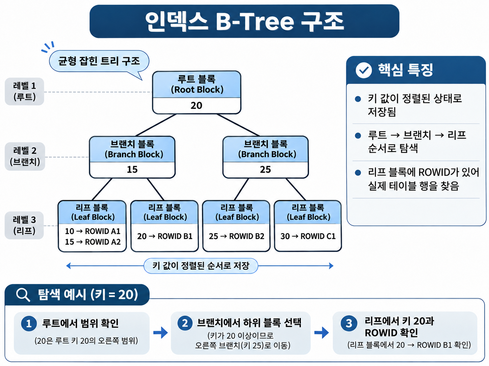

# SQL 기초: 데이터베이스 객체(Object)

## 목차

1. [데이터베이스 객체의 종류](#1-데이터베이스-객체의-종류)
2. [SEQUENCE: 자동 번호 생성](#2-sequence-자동-번호-생성)
3. [INDEX: 데이터 검색 속도 개선](#3-index-데이터-검색-속도-개선)
4. [VIEW: 조회 결과를 가상 테이블로 사용](#4-view-조회-결과를-가상-테이블로-사용)
5. [SYNONYM: 객체의 별칭](#5-synonym-객체의-별칭)

<br>

## 1. 데이터베이스 객체의 종류

**데이터베이스 객체(Object)**는 데이터를 저장하거나, 조회를 돕거나, SQL 작업을 편리하게 만드는 구성 요소다.

| 객체              | 역할                                                                  |
| ----------------- | --------------------------------------------------------------------- |
| **TABLE**         | 행과 열로 데이터를 저장하는 기본 객체                                 |
| **SEQUENCE**      | 일련번호를 자동으로 생성하는 객체                                     |
| **INDEX**         | 원하는 데이터를 빠르게 찾도록 돕는 검색 구조                          |
| **VIEW**          | `SELECT`문을 저장해 테이블처럼 조회하는 가상 테이블                   |
| **SYNONYM**       | 테이블·뷰 등 객체에 붙이는 다른 이름                                  |
| **프로그램 유닛** | Procedure, Function, Trigger, Package 등 SQL·PL/SQL로 작성한 프로그램 |

<br>

## 2. SEQUENCE: 자동 번호 생성

**시퀀스(Sequence)**는 번호를 자동으로 생성하는 독립적인 객체로, 주로 **기본 키(PK)에 들어갈 ID**를 만들 때 사용한다.

여러 사용자나 SQL문이 함께 사용할 수 있지만, **번호가 반드시 연속되지는 않는다.**

생성된 번호는 `ROLLBACK`해도 되돌아가지 않으며, 캐시나 다른 세션의 사용으로 중간 번호가 비어 있을 수 있다.

### 생성과 주요 옵션

```sql
CREATE TABLE OBJ_EMP_TEST (
    ID      NUMBER PRIMARY KEY,
    NAME    VARCHAR2(30 CHAR),
    DEPT_ID NUMBER,
    SALARY  NUMBER
);

CREATE SEQUENCE OBJ_EMP_SEQ
START WITH 1
INCREMENT BY 1
NOCACHE
NOCYCLE;
```

| 옵션                    | 의미                                                                                         |
| ----------------------- | -------------------------------------------------------------------------------------------- |
| `START WITH n`          | 처음 생성할 번호                                                                             |
| `INCREMENT BY n`        | 번호가 증가·감소하는 간격                                                                    |
| `MINVALUE` / `MAXVALUE` | 생성 가능한 번호의 최솟값·최댓값                                                             |
| `CYCLE` / `NOCYCLE`     | 한계에 도달했을 때 다시 순환할지 결정. PK에는 보통 `NOCYCLE` 사용                            |
| `CACHE` / `NOCACHE`     | 번호를 메모리에 미리 확보할지 결정. `CACHE`는 성능에 유리하지만 미사용 번호가 사라질 수 있음 |

### NEXTVAL과 CURRVAL

```sql
INSERT INTO OBJ_EMP_TEST (ID, NAME, DEPT_ID, SALARY)
VALUES (OBJ_EMP_SEQ.NEXTVAL, '홍길동', 110, 2000);

SELECT OBJ_EMP_SEQ.CURRVAL FROM DUAL;
-- 이 세션에서 처음 NEXTVAL을 사용했다면 결과: 1
```

- **`NEXTVAL`**: 시퀀스의 다음 번호를 생성해 반환한다.
- **`CURRVAL`**: **현재 세션에서 마지막으로 생성한 번호**를 반환한다. 해당 세션에서 `NEXTVAL`을 먼저 사용해야 한다.
- 주로 `INSERT ... VALUES`, `INSERT ... SELECT`, `UPDATE ... SET` 등에서 사용한다. `WHERE`, `GROUP BY`, `ORDER BY`, `DISTINCT`와 결합하는 등 **사용할 수 없는 위치도 있다.**

시퀀스는 `ALTER SEQUENCE`로 증가 간격·최댓값·캐시 설정 등을 바꾸고, `DROP SEQUENCE`로 삭제한다.

```sql
ALTER SEQUENCE OBJ_EMP_SEQ INCREMENT BY 2;

SELECT SEQUENCE_NAME, INCREMENT_BY, LAST_NUMBER
FROM USER_SEQUENCES
WHERE SEQUENCE_NAME = 'OBJ_EMP_SEQ';
```

`LAST_NUMBER`는 특히 `CACHE`를 사용할 때 **마지막으로 실제 발급한 번호와 다를 수 있다.** 또한 현재 Oracle에서는 시퀀스의 `NEXTVAL`을 컬럼 `DEFAULT` 값으로 지정할 수도 있다.

<br>

## 3. INDEX

**인덱스(Index)**는 책의 찾아보기처럼 **검색할 값과 해당 행의 위치(ROWID)**를 관리하는 객체다. 조건에 맞는 행이 적다면 테이블 전체를 읽는 대신 인덱스를 통해 빠르게 찾을 수 있다.

Oracle의 대표적인 인덱스는 **B-Tree 기반 인덱스**로, 루트(Root)와 브랜치(Branch) 블록을 거쳐 리프(Leaf) 블록에서 인덱스 키와 `ROWID`를 찾는다. 리프 블록은 정렬된 상태로 서로 연결되어 있다.



- **UNIQUE 인덱스**: 인덱스 키의 중복을 허용하지 않는다. PK·UNIQUE 제약조건을 설정하면 이를 지원하는 인덱스가 자동으로 생성되거나 기존 인덱스가 활용될 수 있다.
- **NON-UNIQUE 인덱스**: 같은 키 값을 여러 행에서 사용할 수 있다.
- **단일 인덱스 / 복합 인덱스**: 컬럼 하나 또는 여러 컬럼을 묶어 만든다.

### 인덱스 생성하기

```sql
-- 부서 번호로 검색할 때 사용할 수 있는 인덱스
CREATE INDEX OBJ_EMP_DEPT_IDX ON OBJ_EMP_TEST (DEPT_ID);

SELECT INDEX_NAME, UNIQUENESS
FROM USER_INDEXES
WHERE TABLE_NAME = 'OBJ_EMP_TEST';
```

### 인덱스는 언제 유리할까?

인덱스는 **조회 조건에 따라 필요한 데이터를 효율적으로 찾을 때** 유리하지만, 모든 상황에서 성능을 향상시키는 것은 아니다.

**인덱스가 유리한 경우**

- `WHERE`나 `JOIN` 조건에 자주 사용되며, 검색 범위를 효과적으로 좁힐 수 있는 컬럼
- **전체 데이터 중 조회 조건에 해당하는 행이 비교적 적은 경우**

**인덱스 생성 및 사용에 주의가 필요한 경우**

- 테이블이 작거나, **조회해야 할 데이터가 전체의 대부분인 경우** → 인덱스를 사용하는 것보다 **테이블 풀 스캔(Full Table Scan)**이 효율적일 수 있다.
- `INSERT`·`UPDATE`·`DELETE`가 빈번하여 **인덱스 유지 비용이 커지는 경우**
- 인덱스를 지나치게 많이 생성하여 **저장 공간과 관리 부담이 증가하는 경우**

### 인덱스 삭제하기

```sql
DROP INDEX OBJ_EMP_DEPT_IDX;
```

<br>

## 4. VIEW: 조회 결과를 가상 테이블로 사용

**뷰(View)**는 테이블이나 다른 뷰를 기반으로 **`SELECT`문을 저장하여 테이블처럼 사용할 수 있게 만든 가상 테이블**이다.

일반 뷰는 데이터를 별도로 저장하지 않고, **뷰를 조회하면 저장된 SQL을 바탕으로 원본 테이블의 데이터를 보여준다.**

### 뷰의 장점

- **보안성 향상**: 필요한 컬럼과 행만 제공하도록 뷰를 정의하여 민감한 데이터에 대한 접근을 제한할 수 있다.
- **SQL 단순화**: 복잡한 `JOIN`이나 조회 조건을 뷰에 정의하면 간단한 `SELECT`문으로 결과를 조회할 수 있다.
- **재사용성**: 자주 사용하는 조회 SQL을 뷰로 정의하여 여러 곳에서 반복해서 사용할 수 있다.

### 뷰 생성하기

```sql
CREATE OR REPLACE VIEW OBJ_EMP_110_V AS
SELECT ID, NAME, DEPT_ID, SALARY
FROM OBJ_EMP_TEST
WHERE DEPT_ID = 110
WITH CHECK OPTION;

SELECT * FROM OBJ_EMP_110_V;
```

| 옵션                | 역할                                                                           |
| ------------------- | ------------------------------------------------------------------------------ |
| `OR REPLACE`        | 기존 뷰를 삭제하지 않고 정의를 변경                                            |
| `FORCE` / `NOFORCE` | 기본 테이블이 없어도 뷰 생성을 허용할지 지정 (`NOFORCE`가 기본)                |
| `WITH CHECK OPTION` | 뷰를 통한 `INSERT`·`UPDATE` 결과가 **뷰의 조회 조건을 벗어나지 못하도록** 제한 |
| `WITH READ ONLY`    | 뷰를 통한 `INSERT`·`UPDATE`·`DELETE` 방지                                      |

예제의 뷰에서는 `DEPT_ID = 110`인 행을 조회할 수 있다. 뷰를 통해 `DEPT_ID`를 `112`로 수정하면 **뷰의 조회 조건을 벗어나므로 `WITH CHECK OPTION`에 의해 거부된다.**

**뷰 생성 시 알아둘 점**

- 뷰를 정의하는 `SELECT`문에는 `JOIN`, `GROUP BY`, 서브쿼리 등을 사용할 수 있다.
- 조회 결과의 정렬이 필요하다면 **뷰를 조회하는 `SELECT`문에서 `ORDER BY`를 지정**하는 것이 좋다.

**뷰를 통한 DML**

뷰를 통해서도 `INSERT`·`UPDATE`·`DELETE`를 수행할 수 있지만, **뷰의 구조에 따라 제한될 수 있다.**

- **DML이 가능한 경우**: 하나의 테이블을 단순 조회하는 뷰는 일반적으로 DML이 가능하다.
- **DML이 제한되는 경우**: `GROUP BY`, 집계 함수, `DISTINCT`, 계산식, `JOIN` 등이 포함된 뷰는 DML에 제한이 생길 수 있다.

### 뷰 삭제하기

```sql
SELECT VIEW_NAME FROM USER_VIEWS
WHERE VIEW_NAME = 'OBJ_EMP_110_V';

DROP VIEW OBJ_EMP_110_V;
```

<br>

## 5. SYNONYM: 객체의 별칭

**동의어(Synonym)**는 테이블이나 뷰 등 데이터베이스 객체에 **다른 이름(별칭)을 부여하는 객체**다. 복잡한 객체 이름을 간단하게 사용하거나 원본 객체의 이름을 직접 드러내지 않을 때 활용한다.

```sql
CREATE SYNONYM OBJ_EMP_ALIAS FOR OBJ_EMP_TEST;

SELECT * FROM OBJ_EMP_ALIAS;
-- OBJ_EMP_TEST를 조회하는 것과 같음

DROP SYNONYM OBJ_EMP_ALIAS;
```

- **개인 동의어(Private Synonym)**: 특정 스키마에 속하는 동의어로, `CREATE SYNONYM`으로 생성한다.
- **공용 동의어(Public Synonym)**: 모든 사용자가 이름을 참조할 수 있는 동의어로, `CREATE PUBLIC SYNONYM`으로 생성한다. 생성하려면 별도의 시스템 권한이 필요하다.

**동의어를 생성해도 원본 객체에 대한 접근 권한이 자동으로 부여되지는 않는다.**

```sql
-- 실습 종료 후 객체 정리
DROP TABLE OBJ_EMP_TEST;
DROP SEQUENCE OBJ_EMP_SEQ;
```

<br>

## 참고 자료

- 『SQL의 정석』 13장 — OBJECT
