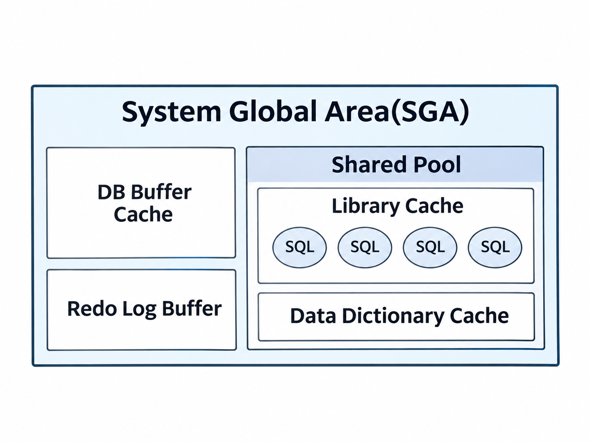
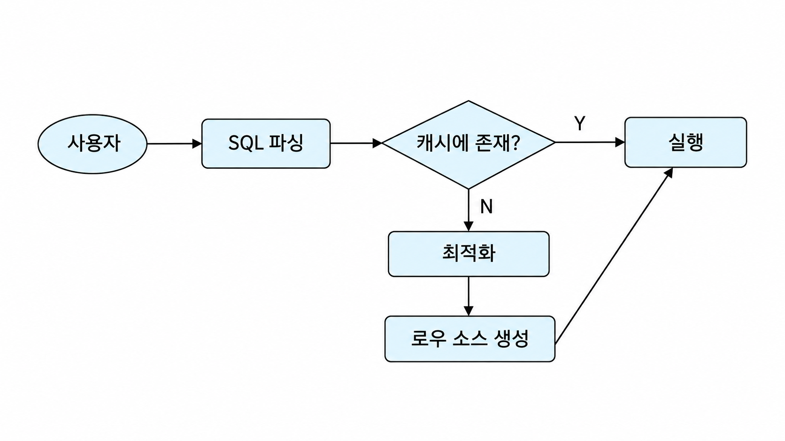
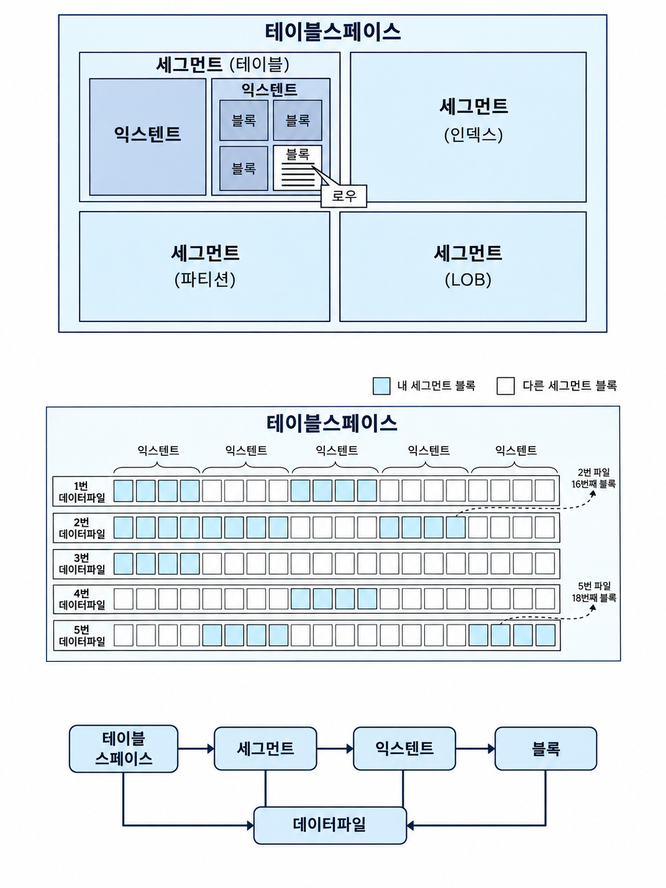
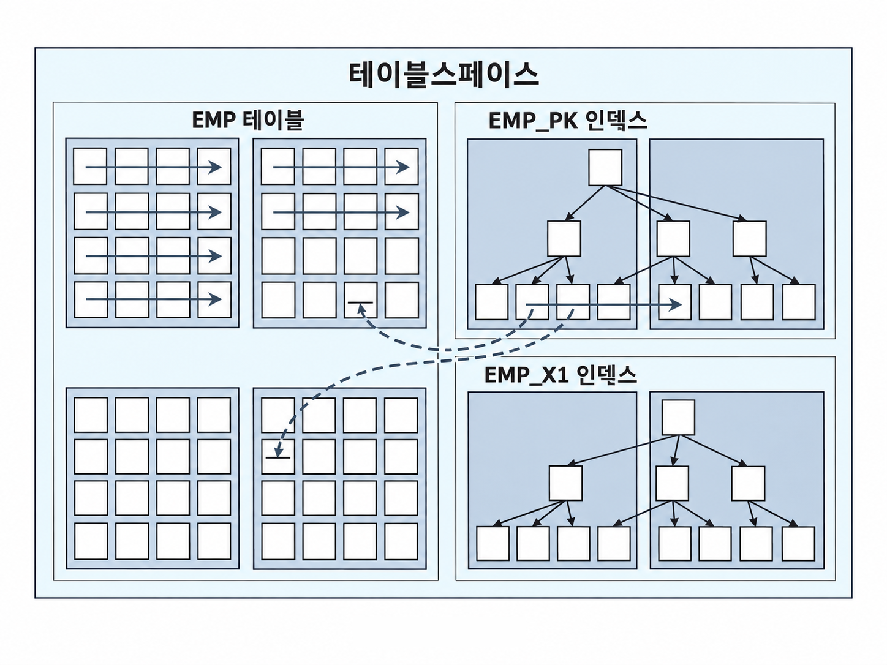
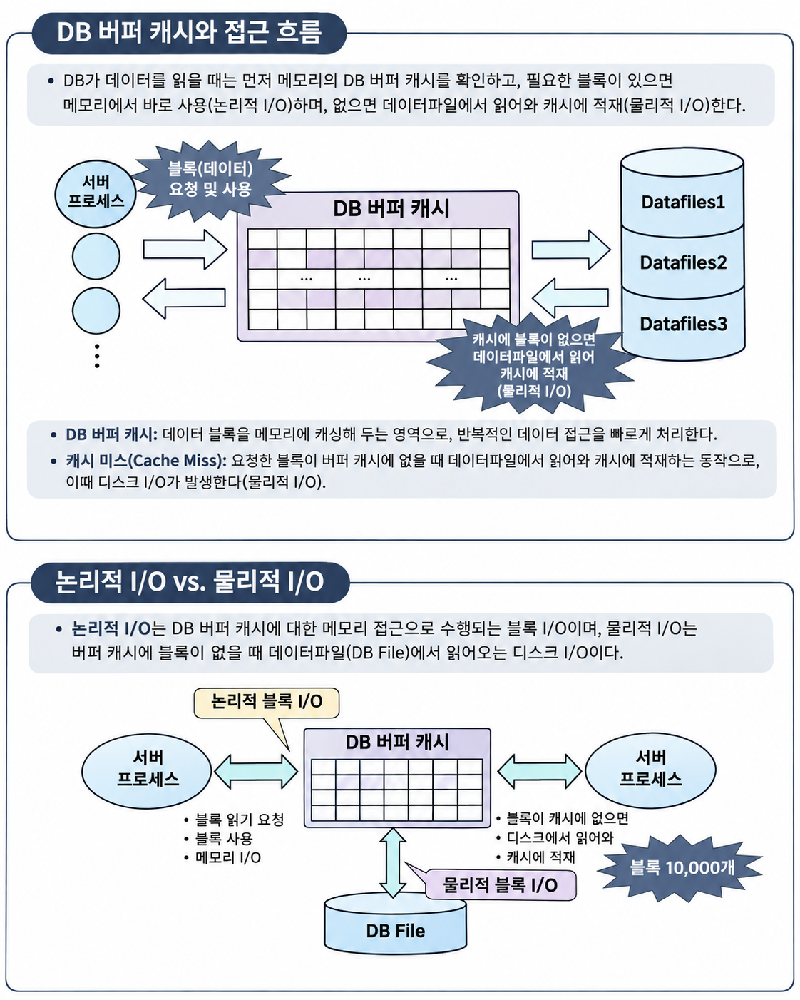
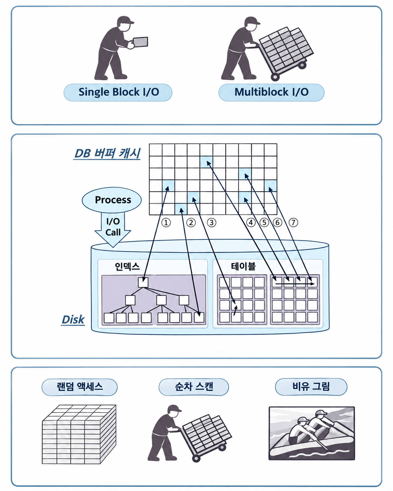
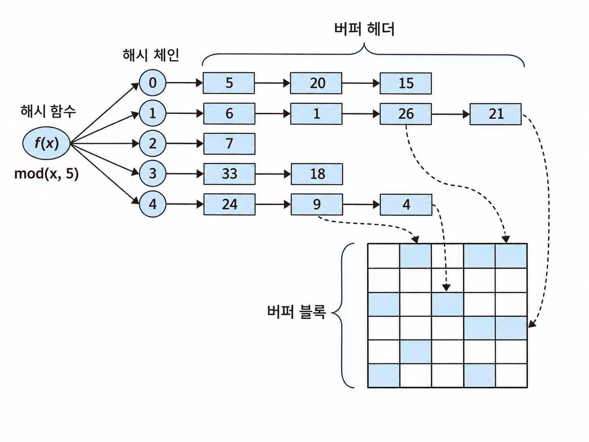

# SQL 처리 과정과 I/O

1. [SQL 파싱과 최적화](#1-sql-파싱과-최적화)
2. [SQL 공유 및 재사용](#2-sql-공유-및-재사용)
3. [데이터 저장 구조 및 I/O 메커니즘](#3-데이터-저장-구조-및-io-메커니즘)
4. [핵심 개념 정리](#4-핵심-개념-정리)

## 1. SQL 파싱과 최적화

### 1.1. SQL은 선언적·집합적 언어

SQL은 **구조적(Structured), 집합적(Set-based), 선언적(Declarative) 질의 언어**이다. 개발자는 _무엇을 조회할지(What)_ 선언하지만, 데이터를 _어떤 순서와 방법으로 읽을지(How)_ 일일이 지정하지 않는다.

**SQL 옵티마이저(Optimizer)** 는 데이터 접근 방법, 조인 순서, 조인 방식 등을 결정한다. 즉, SQL의 선언적인 요청을 실행 가능한 처리 절차로 연결해 주는 핵심 엔진이다.

### 1.2. SQL 처리 과정

SQL은 선언적으로 작성되지만, DBMS는 이를 실제로 수행할 수 있는 절차로 변환해야 한다. Oracle의 SQL 처리 과정은 다음과 같다.

| 단계                      | 역할                                                                                                                                                            |
| ------------------------- | --------------------------------------------------------------------------------------------------------------------------------------------------------------- |
| **SQL Parsing**           | SQL을 분석해 파싱 트리(Parse Tree)를 생성하고, 문법 검사(Syntax Check)와 테이블·컬럼의 존재 여부, 접근 권한 등을 확인하는 의미 검사(Semantic Check)를 수행한다. |
| **SQL Optimization**      | 테이블·인덱스·컬럼의 통계정보 등을 활용하여 가능한 실행 경로의 예상 비용을 비교하고 실행 계획(Execution Plan)을 선택한다.                                       |
| **Row Source Generation** | 선택된 실행 계획을 SQL 실행 엔진이 처리할 수 있는 내부 연산 구조로 변환한다.                                                                                    |
| **SQL Execution**         | 실행 계획에 따라 데이터 블록에 접근하고 조회·조인·정렬 등의 연산을 수행하여 결과를 생성한다.                                                                    |

### 1.3. 실행 계획, 비용, 옵티마이저 힌트

- **실행 계획(Execution Plan)**: 테이블·인덱스를 어떤 방식과 순서로 읽을지 나타내는 처리 절차다.
- **비용(Cost)**: 옵티마이저가 실행 방법을 비교하기 위해 계산하는 **상대적인 예상 작업 비용**이다. 실제 실행 시간이나 실제 I/O 횟수 자체는 아니다.
- **옵티마이저 힌트(Hint)**: 개발자가 실행 계획 선택에 영향을 주기 위해 SQL에 작성하는 지시다. 유효하지 않거나 적용할 수 없는 힌트는 무시될 수 있다.

```sql
-- 테이블 전체 스캔을 유도하는 힌트 예시
SELECT /*+ FULL(e) */ e.NAME
FROM S_EMP e
WHERE e.DEPT_ID = 110;
```

**옵티마이저가 선택한 계획이 반드시 실제로 가장 빠른 것은 아니다.** 비용은 통계정보와 실행 환경에 근거한 추정치이기 때문이다.

<br>

## 2. SQL 공유 및 재사용

### 2.1. SGA, Shared Pool, Library Cache

**SGA(System Global Area)** 는 여러 프로세스가 함께 사용하는 공유 메모리 영역이다. SQL 실행 정보를 재사용하거나, 자주 사용하는 데이터 블록을 메모리에 저장하는 데 활용된다.



| 구성 요소                 | 위치             | 역할                                         |
| ------------------------- | ---------------- | -------------------------------------------- |
| **Library Cache**         | Shared Pool 내부 | SQL, 실행 계획 등 공유 커서 관련 정보 재사용 |
| **Data Dictionary Cache** | Shared Pool 내부 | 객체 정의 등 데이터 사전 정보 캐싱           |
| **Database Buffer Cache** | SGA 내부         | 테이블·인덱스의 **데이터 블록** 캐싱         |
| **Redo Log Buffer**       | SGA 내부         | 변경 내용을 복구하기 위한 Redo 정보 버퍼링   |

**Library Cache는 SQL 실행 정보**, **DB Buffer Cache는 실제 데이터 블록**을 저장한다는 차이가 중요하다.

### 2.2. Soft Parsing과 Hard Parsing

같은 SQL이 반복 실행될 때마다 새로운 실행 계획을 만들면 CPU 사용과 공유 메모리 경합이 증가할 수 있다. Oracle은 Library Cache의 공유 커서(Shared Cursor)를 재사용하여 이를 줄인다.



| 구분      | Soft Parse                     | Hard Parse                            |
| --------- | ------------------------------ | ------------------------------------- |
| 발생 상황 | 재사용 가능한 공유 커서를 찾음 | 재사용할 커서가 없거나 사용할 수 없음 |
| 처리      | 기존 실행 정보 재사용          | 최적화·로우 소스 생성 등 수행         |
| 특징      | 상대적으로 비용이 낮음         | CPU와 공유 자원을 더 많이 사용        |

### 2.3. 이름 없는 SQL과 바인드 변수

#### 이름 없는 SQL의 문제

일반적인 저장 프로시저(Stored Procedure)는 고유한 이름을 갖지만, SQL 문은 별도의 고정된 이름이 없다. 따라서 논리적으로 같은 SQL이라도 텍스트가 달라지면 서로 다른 SQL로 취급될 수 있다.

```sql
SELECT NAME FROM S_EMP WHERE DEPT_ID = 110;
SELECT NAME FROM S_EMP WHERE DEPT_ID = 113;
```

조회 조건의 값만 다른 SQL이 반복적으로 생성되면 **Library Cache에 유사한 SQL이 다수 저장되고 불필요한 Hard Parsing이 증가**할 수 있다. 그 결과 CPU 사용량과 공유 메모리 경합이 늘어난다.

#### 바인드 변수(Bind Variable)

**바인드 변수는 SQL에 값을 직접 작성하지 않고, 값이 들어갈 위치를 지정한 뒤 실행 시 실제 값을 전달하는 방식**이다.

```sql
SELECT NAME
FROM S_EMP
WHERE DEPT_ID = :dept_id;
```

`:dept_id`에 다른 값을 전달해도 SQL 텍스트는 같으므로, 공유 커서와 실행 계획의 재사용 가능성이 높아지고 불필요한 Hard Parsing을 줄일 수 있다.

Java에서는 JDBC의 `PreparedStatement`를 통해 바인드 변수를 사용한다.

```java
String sql = "SELECT NAME FROM S_EMP WHERE DEPT_ID = ?";

try (PreparedStatement pstmt = conn.prepareStatement(sql)) {
    pstmt.setInt(1, 110);

    try (ResultSet rs = pstmt.executeQuery()) {
        while (rs.next()) {
            System.out.println(rs.getString("NAME"));
        }
    }
}
```

- **성능:** SQL과 실행 계획의 재사용 가능성을 높여 Hard Parsing 부담을 줄인다.
- **보안:** 사용자 입력값을 SQL 명령과 분리하여 데이터로 처리하므로 SQL Injection을 방지한다.

예를 들어 사용자 입력값에 `' OR '1'='1`과 같은 문자열이 포함되어도, 바인딩된 값은 SQL 조건식으로 해석되지 않고 하나의 문자열 데이터로 처리된다.

> **주의:** 바인드 변수를 사용하더라도 실행 환경 등에 따라 Hard Parsing이 발생할 수 있으므로, 항상 Soft Parsing이 보장되는 것은 아니다.

<br>

## 3. 데이터 저장 구조 및 I/O 메커니즘

### 3.1. 데이터베이스가 I/O 때문에 느려지는 이유

SQL을 실행할 때는 필요한 데이터 블록에 접근한다. 디스크에서 블록을 읽는 작업은 메모리 접근보다 일반적으로 느리므로, **물리적 I/O가 많거나 대기 시간이 길어지면 SQL 성능이 저하될 수 있다.**

### 3.2. Oracle 데이터 저장 구조



| 구성 요소      | 의미                                                 |
| -------------- | ---------------------------------------------------- |
| **Tablespace** | 세그먼트들을 담는 논리적 저장 공간                   |
| **Segment**    | 테이블·인덱스 등 객체에 할당된 저장 공간             |
| **Extent**     | 공간을 확장·할당하는 단위. 연속된 데이터 블록의 집합 |
| **Data Block** | Oracle에서 데이터를 저장하고 읽는 기본 단위          |
| **Datafile**   | 테이블스페이스를 구성하는 물리적인 파일              |

**논리적 포함 관계:** `Tablespace → Segment → Extent → Block`

실제 블록은 Datafile에 저장된다. 한 Extent의 블록은 같은 데이터 파일 내에서 연속되지만, **한 Segment에 속한 서로 다른 Extent들은 떨어져 있거나 여러 Datafile에 분산될 수 있다.**

### 3.3. DBA와 ROWID

- **DBA(Data Block Address)**: 데이터 파일과 블록 위치를 식별하는 주소.
- **ROWID**: 특정 행의 저장 위치를 나타내는 의사 컬럼(Pseudocolumn). 일반적인 확장 ROWID에는 데이터 객체 번호, 상대 파일 번호, 블록 번호, 블록 안의 행 위치가 포함된다.

```sql
SELECT ID, NAME, ROWID
FROM S_EMP
WHERE ID = 1;
```

인덱스에서 ROWID를 얻으면 이를 통해 해당 테이블 블록과 블록 내 행에 접근할 수 있다. 다만 ROWID는 데이터 이동·테이블 재구성 등에 따라 달라질 수 있으므로 **기본키(PK)를 대신하는 영구 식별자로 사용하지 않는다.**

### 3.4. 블록 단위 I/O

Oracle은 일반적인 테이블·인덱스 데이터를 **블록(Block) 단위**로 저장하고 읽는다. 행 하나의 컬럼 하나만 필요해도, 그 행을 읽기 위해서는 해당 블록에 접근해야 한다.

블록 크기는 환경에 따라 달라지며, 일반적인 Oracle 설치에서는 `8KB`를 자주 사용한다. 이를 확인하려면 다음과 같이 조회할 수 있다.

```sql
SELECT VALUE
FROM V$PARAMETER
WHERE NAME = 'db_block_size';
-- 일부 동적 성능 뷰는 조회 권한이 필요할 수 있음
```

### 3.5. 시퀀셜 액세스와 랜덤 액세스

**시퀀셜 액세스(Sequential Access)** 는 논리적·물리적으로 연결된 순서에 따라 블록을 차례로 읽는 방식이다. 테이블 전체 스캔은 Extent Map을 참고하여 테이블 블록을 순서대로 읽고, 인덱스 리프 블록도 연결 정보를 따라 순서대로 탐색할 수 있다.

**랜덤 액세스(Random Access)** 는 순서와 관계없이 필요한 블록 주소로 직접 접근하는 방식이다. 대표적인 사례는 인덱스에서 찾은 `ROWID`를 이용해 테이블 블록을 읽는 작업이다.



| 구분      | Sequential Access                      | Random Access                  |
| --------- | -------------------------------------- | ------------------------------ |
| 읽는 방식 | 순서대로 블록 탐색                     | 필요한 블록의 주소로 직접 접근 |
| 대표 사례 | Table Full Scan, 인덱스 리프 순차 탐색 | ROWID를 이용한 테이블 접근     |
| 유의점    | 많이 읽을 때 유리할 수 있음            | 소량의 특정 블록을 찾기에 적합 |

**시퀀셜/랜덤은 블록의 접근 순서**를 구분하는 개념이다. 한 번의 디스크 요청으로 읽는 블록 개수를 뜻하지는 않는다.

### 3.6. DB Buffer Cache와 논리적·물리적 I/O

**DB Buffer Cache**는 데이터 블록을 메모리에 저장하여 불필요한 디스크 I/O를 줄이는 SGA의 공유 메모리 영역이다.

일반적인 버퍼 캐시 경유 읽기에서는 필요한 블록을 캐시에서 찾고, 없으면 디스크에서 읽어 캐시에 적재한다.



- **논리적 I/O(Logical I/O):** DB Buffer Cache의 데이터 블록에 접근하는 작업
- **물리적 I/O(Physical I/O):** 디스크(스토리지)에서 데이터 블록을 실제로 읽어오는 작업

| 상황                                | 논리적 I/O                    | 물리적 I/O               |
| ----------------------------------- | ----------------------------- | ------------------------ |
| **Cache Hit** (캐시에 블록이 있음)  | 캐시에서 블록에 접근          | 발생하지 않음            |
| **Cache Miss** (캐시에 블록이 없음) | 디스크에서 가져온 블록에 접근 | 디스크에서 블록을 읽어옴 |

예를 들어 SQL이 `A → B → C → A` 순서로 블록에 접근하고, 처음에 A만 캐시에 있었다면 다음과 같다.

- **논리적 I/O: 4회** — A, B, C, A에 각각 접근
- **물리적 I/O: 2블록** — 캐시에 없던 B, C를 디스크에서 읽음

**버퍼 캐시 적중률(Buffer Cache Hit Ratio)이 높다고 SQL이 반드시 효율적인 것은 아니다.** 같은 블록을 불필요하게 반복해서 읽으면 디스크 I/O가 적더라도 논리적 I/O가 증가한다.

따라서 SQL의 데이터 접근 비용을 줄이려면 **불필요한 논리적 I/O 자체를 줄이는 것**이 중요하다.

※ 병렬 조회 등에서 사용하는 **Direct Path Read**는 DB Buffer Cache를 거치지 않고 디스크의 데이터를 PGA로 직접 읽을 수 있다.

### 3.7. Single Block I/O와 Multiblock I/O

**Single Block I/O와 Multiblock I/O**는 한 번의 물리적 I/O 요청(I/O Call)으로 읽어오는 데이터 블록의 개수에 따른 구분이다.



| 구분      | Single Block I/O                    | Multiblock I/O                               |
| --------- | ----------------------------------- | -------------------------------------------- |
| 읽는 단위 | 한 번에 한 블록                     | 한 번에 여러 인접 블록                       |
| 대표 사례 | 인덱스 탐색, ROWID 기반 테이블 접근 | Table Full Scan                              |
| 특징      | 필요한 특정 블록을 읽는 데 적합     | 많은 블록을 한꺼번에 읽어 I/O 요청 횟수 감소 |

**Multiblock I/O는 여러 블록을 한 번에 읽어 I/O 요청 횟수와 대기 시간을 줄일 수 있으므로, 대량 데이터를 읽을 때 유리하다.**

다만 Multiblock I/O는 일반적으로 **Extent 경계를 넘어 블록을 한 번에 읽지 않는다.**

예를 들어 하나의 Extent에 20개 블록이 있고 한 번에 최대 8개씩 읽는다면, **8 + 8 + 4블록**으로 나누어 읽는다.

※ 실제 물리적 I/O 발생 여부와 읽는 블록 수는 버퍼 캐시 상태 등에 따라 달라질 수 있다.

### 3.8. Table Full Scan vs. Index Range Scan

테이블의 데이터를 조회하는 대표적인 방식에는 **Table Full Scan**과 **인덱스를 이용한 테이블 접근**이 있다.

| 구분                | Table Full Scan                  | Index Range Scan을 통한 테이블 접근           |
| ------------------- | -------------------------------- | --------------------------------------------- |
| 처리 방식           | 테이블 블록을 스캔하며 조건 검사 | 인덱스에서 ROWID를 얻어 테이블 접근           |
| 블록 접근 방식      | 시퀀셜 액세스                    | 인덱스 리프는 순차 탐색, 테이블은 랜덤 액세스 |
| 일반적인 물리적 I/O | Multiblock I/O                   | 테이블 접근 시 주로 Single Block I/O          |
| 유리한 경우         | 대량 데이터 조회, 집계·배치      | 대규모 테이블에서 소량 데이터 조회            |

**인덱스가 항상 빠른 것은 아니다.** 조회할 행이 많으면 ROWID 기반 **테이블 랜덤 액세스가 반복**되어 논리적 I/O가 증가할 수 있다. 반면 Table Full Scan은 많은 블록을 순차적으로 읽으며 Multiblock I/O를 활용할 수 있어 대량 조회에 더 유리할 수 있다.

### 3.9. 캐시 탐색과 래치(Latch)

Oracle은 DB Buffer Cache에서 원하는 블록을 효율적으로 찾기 위해 **해시 구조(Hash Structure)** 를 사용한다.

블록 주소(DBA)에 해시 함수(Hash Function)를 적용해 해당 **해시 체인(Hash Chain)** 을 찾고, 연결된 버퍼 헤더(Buffer Header)를 통해 실제 버퍼 블록에 접근한다.

<p></p>

그림에서는 `mod(x, 5)`를 해시 함수로 가정한다. 예를 들어 20번 블록은 `20 % 5 = 0`이므로 0번 해시 체인을 탐색한다.

이러한 방식으로 **전체 버퍼 캐시를 검색하지 않고 원하는 블록의 탐색 범위를 좁힐 수 있다.**

#### 래치(Latch)와 버퍼 Lock

DB Buffer Cache는 여러 서버 프로세스가 공유하는 메모리이므로 동시 접근을 제어하는 동기화 메커니즘이 필요하다.

- **Latch:** 해시 체인과 같은 공유 자료구조를 안전하게 탐색·관리하도록 보호하는 동기화 장치
- **Buffer Lock:** 개별 버퍼 블록에 대한 접근을 보호하는 내부 동기화 메커니즘으로, 트랜잭션의 Row Lock과는 구별된다.

**버퍼 캐시에 데이터가 있더라도 탐색과 동기화에는 비용이 발생하므로, 불필요한 블록 접근을 줄이는 것이 중요하다.**

<br>

## 4. 핵심 개념 정리

SQL은 원하는 결과를 선언하고, DBMS는 실행 계획을 결정하거나 기존 계획을 재사용하여 데이터를 처리한다.

**SQL 처리 과정과 데이터 접근 흐름**은 다음과 같다.

```text
SQL 요청
   ↓
SQL Parsing 및 공유 커서 탐색 (Library Cache)
   ├─ 재사용 가능 → 기존 실행 계획 활용 (Soft Parse)
   └─ 재사용 불가 → Optimization · Row Source Generation (Hard Parse)
   ↓
실행 계획에 따라 테이블·인덱스 블록 접근
   ↓
DB Buffer Cache 탐색
   ├─ Cache Hit  → 메모리의 블록 사용
   └─ Cache Miss → 디스크에서 블록을 읽어 캐시에 적재
   ↓
SQL 연산 수행 및 결과 반환
```

※ 일반적인 버퍼 캐시 경유 조회를 단순화한 흐름이다.

**핵심은 SQL의 성능이 실행 계획과 데이터 블록 접근 방식에 크게 영향을 받는다는 점이다.** 따라서 인덱스 사용 여부나 캐시 적중률만 판단하기보다, SQL이 실제로 얼마나 많은 블록에 접근하는지 이해하는 것이 중요하다.

<br>

## 참고 자료

- 『친절한 SQL 튜닝』
