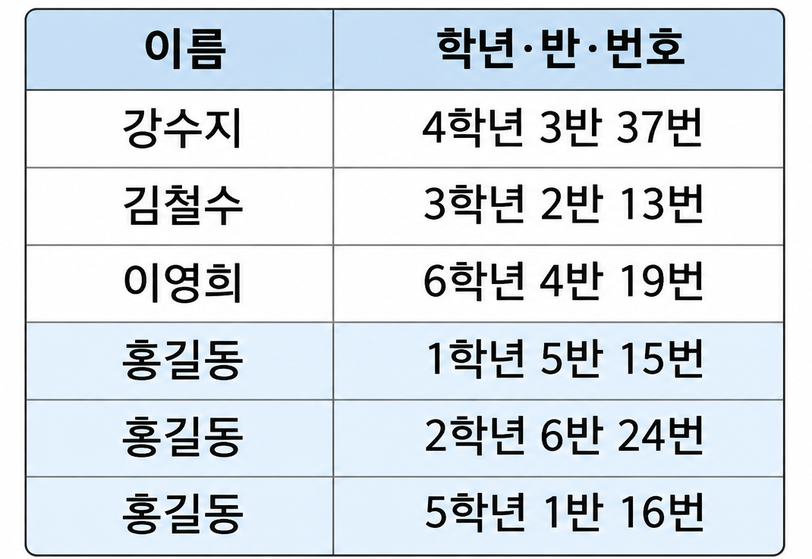
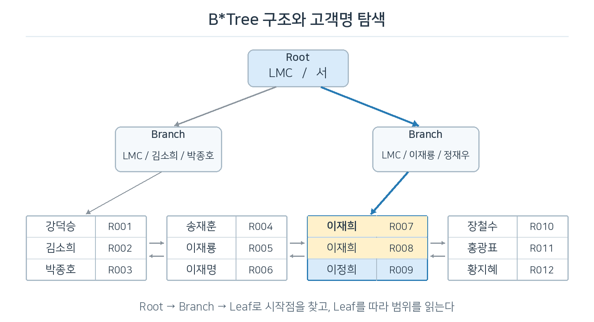
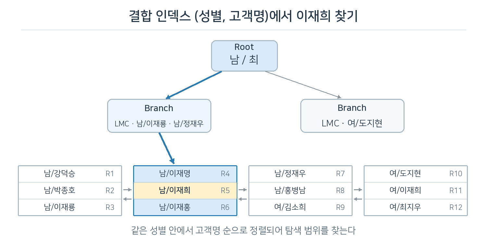
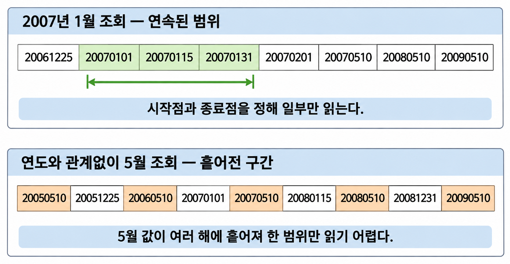
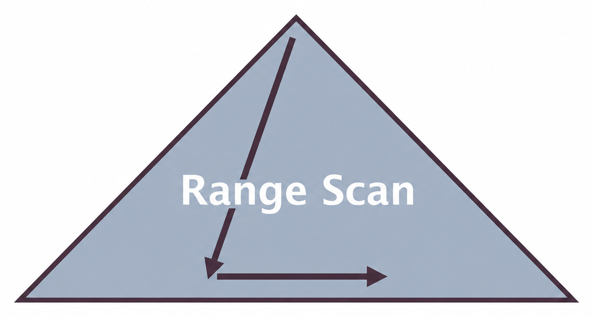
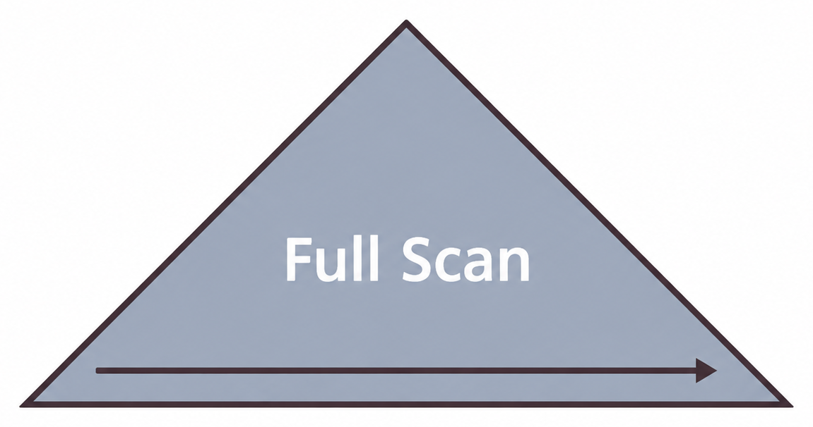
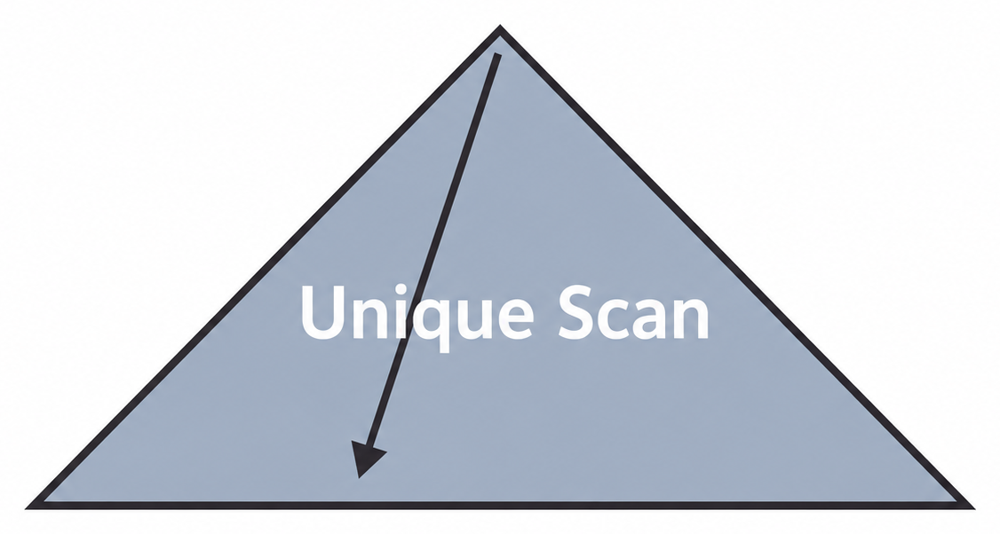
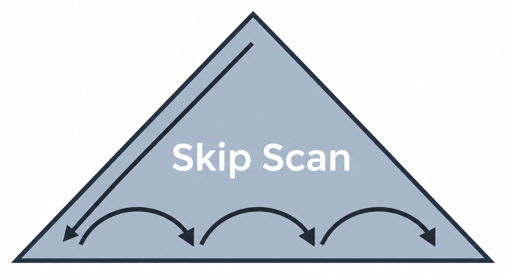
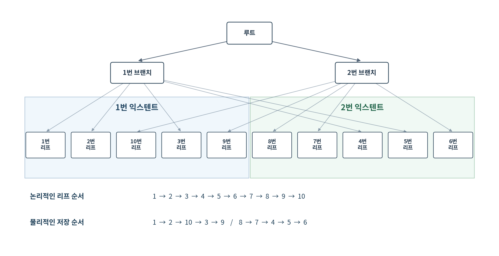
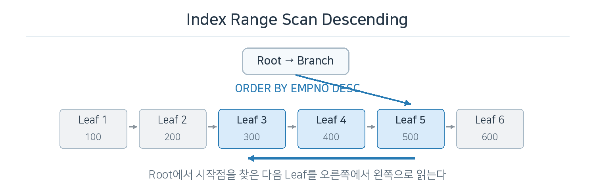

# SQL 튜닝: 인덱스 기본

## 목차

1. [인덱스 구조 및 탐색](#1-인덱스-구조-및-탐색)
2. [인덱스 기본 사용법](#2-인덱스-기본-사용법)
3. [인덱스 스캔 방식 6가지](#3-인덱스-스캔-방식-6가지)
4. [정리](#4-정리)

<br>

인덱스가 데이터를 어떻게 저장하고 탐색하는지 살펴본다.

## 1. 인덱스 구조 및 탐색

### 1.1. 인덱스의 역할

데이터베이스가 데이터를 찾는 대표적인 방법은 **테이블 전체를 스캔하는 것(Table Full Scan)** 과 **인덱스를 이용하는 것(Index Scan)** 이다.

| 방법                | 데이터 검색 방식                                 | 일반적으로 유리한 경우        |
| ------------------- | ------------------------------------------------ | ----------------------------- |
| **Table Full Scan** | 테이블 전체를 읽으며 조건에 맞는 행을 찾는다.    | 많은 데이터를 읽을 때         |
| **Index Scan**      | 인덱스에서 키를 찾고 필요하면 테이블에 접근한다. | 전체 중 적은 데이터를 찾을 때 |

책의 학생 명부를 생각해 보자. 모든 교실을 돌아다니는 대신 **이름순으로 정렬된 명부**에서 학생을 찾고 학년·반·번호를 확인하면 해당 학생이 있는 교실로 갈 수 있다.

<p>&emsp;</p>

**이름은 인덱스 키(Key)**, **학년·반·번호는 위치 정보**에 해당한다. 실제 Oracle 인덱스는 정렬된 키와 테이블 행의 위치를 나타내는 **ROWID**를 관리한다.

인덱스가 정렬되어 있다고 해서 **테이블 자체도 같은 순서로 정렬된 것은 아니다.**

### 1.2. B\*Tree 인덱스 구조와 ROWID

**B\*Tree 인덱스**는 루트에서 모든 리프까지의 높이가 같은 **균형 트리(Balanced Tree)** 구조다.

| 블록       | 역할                                         |
| ---------- | -------------------------------------------- |
| **Root**   | 탐색이 시작되는 최상위 블록                  |
| **Branch** | 키 값과 하위 블록 주소를 통해 탐색 경로 결정 |
| **Leaf**   | 정렬된 키와 ROWID 저장                       |

리프 블록은 키 값 순으로 정렬되어 있고, **양방향 연결 리스트(Doubly Linked List)로** 서로 연결된다. 따라서 필요한 위치를 찾으면 인접한 리프 블록을 따라 앞뒤로 탐색할 수 있다.

<p>&emsp;</p>

**ROWID**는 테이블의 행을 찾아가기 위한 위치 정보다. ROWID에는 데이터 객체 번호와 데이터 파일·블록·블록 안의 행 위치 정보가 포함된다. 인덱스에서 ROWID를 얻은 뒤, 필요한 경우 해당 테이블 행에 접근한다.

### 1.3. 수직적 탐색과 수평적 탐색

B\*Tree 인덱스 탐색은 두 과정으로 구분한다.

1. **수직적 탐색(Vertical Scan)**: Root → Branch → Leaf를 내려가 **조건에 맞는 첫 번째 인덱스 레코드**, 즉 스캔 시작점을 찾는다.
2. **수평적 탐색(Horizontal Scan)**: 찾은 위치부터 리프 레코드를 순서대로 읽으며 **조건에 맞는 나머지 값**을 찾는다. 필요하면 다음 리프 블록으로 이동한다.

예를 들어 `고객명 = '이재희'`를 검색하면 먼저 수직적으로 첫 번째 `이재희`를 찾고, 이어서 같은 이름의 레코드를 수평적으로 읽는다. 다른 이름을 만나면 검색을 멈출 수 있다.

**수직적 탐색은 시작점을 찾는 과정이고, 수평적 탐색은 필요한 범위를 읽는 과정**이다.

### 1.4. 결합 인덱스의 구조와 컬럼 순서

**결합 인덱스(Composite Index)** 는 두 개 이상의 컬럼으로 만든 인덱스다.

예를 들어 `(성별, 고객명)` 인덱스는 **성별 순으로 정렬하고, 같은 성별 안에서 고객명 순으로 정렬**한다.

```sql
CREATE INDEX 고객_N1 ON 고객 (성별, 고객명);

SELECT *
FROM 고객
WHERE 성별 = '남'
  AND 고객명 = '이재희';
```

<p>&emsp;</p>

위 조회는 인덱스에서 **`(남, 이재희)`가 처음 나타나는 위치를 찾아간 다음**, 같은 키가 이어지는 구간을 읽는다. 즉, 결합 인덱스도 여러 컬럼을 조합한 **하나의 정렬된 키**를 이용해 탐색한다.

결합 인덱스는 선두 컬럼부터 순서대로 정렬되므로 컬럼 순서에 따라 검색 효율이 달라진다.

예를 들어 (성별, 고객명) 인덱스는 성별별로 고객명이 정렬되어 있어 두 컬럼을 모두 검색할 때 효율적이다. 하지만 고객명만 검색하면 같은 이름이 성별 구간마다 나뉘어 있어 일반적인 Index Range Scan이 어렵다.

<br>

## 2. 인덱스 기본 사용법

### 2.1. Index Range Scan과 선두 컬럼

**Index Range Scan**은 정렬된 인덱스에서 **검색 시작점을 찾아 필요한 범위만 읽다가 멈추는 방식**이다.

예를 들어 생년월일이 `YYYYMMDD` 형식의 문자열이고, `생년월일`에 B\*Tree 인덱스가 있다고 하자.

```sql
WHERE 생년월일 BETWEEN '20070101' AND '20070131'
```

<p>&emsp;</p>

2007년 1월에 해당하는 값은 인덱스의 한 구간에 모여 있어 시작점과 종료점을 찾을 수 있다.

반면 연도와 관계없이 5월에 태어난 사람을 찾으려면 여러 연도에 흩어진 데이터를 검색해야 하므로 하나의 연속된 범위로 찾기 어렵다.

**일반적인 Index Range Scan을 하려면 인덱스의 선두 컬럼을 이용해 검색 시작점을 찾을 수 있어야 한다.**

예를 들어 `(소속팀, 사원명, 연령)` 인덱스는 소속팀을 기준으로 먼저 정렬되어 있으므로, `소속팀` 조건이 있으면 해당 구간을 찾아갈 수 있다. 반면 `사원명`만 검색하면 같은 이름이 여러 소속팀 구간에 흩어져 있어 일반적인 Range Scan이 어렵다.

### 2.2. 인덱스 컬럼 가공과 검색 조건의 제약

**조건절에서 인덱스 컬럼을 가공하면 일반적인 Index Range Scan을 활용하기 어렵다.** 인덱스에는 가공하기 전의 값이 정렬되어 있으므로, 가공한 값을 기준으로 검색 범위를 바로 찾기 어렵기 때문이다.

다음 네 가지 조건은 **한 번의 연속된 인덱스 범위 검색**으로 처리하기 어려울 수 있다.

| 조건                 | 예시                                      | 이유                                                       |
| -------------------- | ----------------------------------------- | ---------------------------------------------------------- |
| **컬럼 가공**        | `SUBSTR(생년월일, 5, 2) = '05'`           | 5월에 해당하는 값이 여러 연도에 흩어져 있음                |
| **`LIKE` 포함 검색** | `업체명 LIKE '%대한%'`                    | '대한'을 포함하는 값이 인덱스 여러 곳에 흩어져 있음        |
| **`OR` 조건**        | `전화번호 = :tel_no OR 고객명 = :cust_nm` | 서로 다른 검색 조건을 하나의 인덱스 범위로 처리하기 어려움 |
| **`IN` 조건**        | `전화번호 IN (:tel_no1, :tel_no2)`        | 검색할 값들이 인덱스의 서로 다른 위치에 존재할 수 있음     |

`LIKE`는 **검색 문자열의 위치**에 따라 차이가 있다.

```sql
WHERE 업체명 LIKE '대한%'   -- '대한'으로 시작: 한 구간에 모여 Range Scan 가능
WHERE 업체명 LIKE '%대한%'  -- '대한'을 포함: 여러 구간에 흩어져 일반적인 Range Scan 어려움
```

`OR`과 `IN`은 **하나의 연속된 범위를 찾기 어렵더라도 여러 번의 인덱스 탐색으로 처리할 수 있다.**

- **`OR` 조건:** 고객명 또는 전화번호로 검색할 때, Oracle은 각 조건을 나누어 인덱스를 탐색하고 결과를 합칠 수 있다. 이를 **OR Expansion**이라고 한다.
- **`IN` 조건:** 여러 전화번호를 검색할 때, Oracle은 같은 전화번호 인덱스에서 각 값을 반복해서 검색할 수 있다. 이를 **IN-List Iterator**라고 한다.

### 2.3. 인덱스 정렬을 활용한 소트 연산 생략

인덱스는 키가 정렬되어 있으므로 **인덱스를 읽는 순서와 `ORDER BY`의 정렬 순서가 같으면 별도의 소트(Sort) 연산을 생략**할 수 있다.

예를 들어 상태변경이력의 인덱스가 `(장비번호, 변경일자, 변경순번)` 순서로 구성되어 있다고 하자.

```sql
SELECT *
FROM 상태변경이력
WHERE 장비번호 = 'C'
  AND 변경일자 = '20180316'
ORDER BY 변경순번;
```

앞의 두 컬럼이 `=` 조건으로 고정되어 있으므로, 해당 인덱스 범위의 데이터는 `변경순번` 순서로 정렬되어 있다. 따라서 **인덱스 순서대로 데이터를 읽으면 별도의 `SORT ORDER BY` 연산을 생략할 수 있다.**

`SELECT`절에서 원본 컬럼과 같은 이름의 별칭을 만들 때도 주의해야 한다.

```sql
-- 인덱스: (주문일자, 주문번호)
SELECT TO_CHAR(A.주문번호, 'FM000000') AS 주문번호,
       A.업체번호, A.주문금액
FROM 주문 A
WHERE A.주문일자 = :dt
ORDER BY 주문번호;    -- SELECT절의 별칭(가공된 문자열)을 가리킴

-- 원본 숫자 컬럼으로 정렬하려면
-- ORDER BY A.주문번호;
```

인덱스는 키가 정렬되어 있어 **최솟값·최댓값(`MIN/MAX`)을 찾을 때도 활용**할 수 있다.

예를 들어 `(장비번호, 변경일자, 변경순번)` 인덱스에서 앞의 두 컬럼을 `=` 조건으로 검색하면, 해당 데이터는 `변경순번` 순서로 정렬되어 있다. 따라서 **가장 앞이나 뒤의 값만 읽어 최소·최댓값을 찾는 최적화**가 가능하다.

하지만 **집계 대상 컬럼을 가공하면 인덱스의 정렬 순서를 활용하기 어려워질 수 있다.**

```sql
-- 변경순번을 숫자로 변환한 후 최댓값 검색
SELECT NVL(MAX(TO_NUMBER(변경순번)), 0)
FROM 상태변경이력
WHERE 장비번호 = 'C' AND 변경일자 = '20180316';

-- 문자열 상태로 최댓값을 찾은 후 숫자로 변환
SELECT NVL(TO_NUMBER(MAX(변경순번)), 0)
FROM 상태변경이력
WHERE 장비번호 = 'C' AND 변경일자 = '20180316';
```

첫 번째는 **각 값을 숫자로 변환한 후 최댓값을 찾지만**, 두 번째는 **인덱스에 정렬된 문자열에서 최댓값을 먼저 찾으므로** 최적화에 유리하다.

### 2.4. 자동 형변환 주의

Oracle은 서로 다른 자료형을 비교할 때 **자동 형변환(Implicit Type Conversion)**을 수행할 수 있다. 이 과정에서 인덱스 컬럼이 변환되면 기존 인덱스의 정렬 순서를 활용하기 어려워질 수 있다.

예를 들어 `가입일자`가 `DATE` 타입인 경우를 보자.

```sql
-- 문자열을 날짜로 자동 변환
SELECT * FROM 고객
WHERE 가입일자 = '20180101';

-- TO_DATE()로 날짜 형식을 명시하여 변환
SELECT * FROM 고객
WHERE 가입일자 = TO_DATE('20180101', 'YYYYMMDD');
```

첫 번째는 Oracle이 문자열을 날짜로 자동 변환하며, 이때 세션의 날짜 형식 설정에 따라 오류가 발생하거나 예상과 다르게 처리될 수 있다.

반면 두 번째는 **`TO_DATE()`로 비교값의 자료형과 형식을 명확히 지정**하므로 이러한 문제를 방지할 수 있다.

따라서 자동 형변환에 의존하기보다 **비교값의 자료형을 컬럼에 맞추고, 인덱스 컬럼 자체는 가능한 한 가공하지 않는 것**이 중요하다.

<br>

## 3. 인덱스 스캔 방식 6가지

인덱스 스캔 방식은 **어디서 시작해 어느 범위를 어떤 순서로 읽는지**에 따라 구분한다.

### 3.1. Index Range Scan

**Index Range Scan**은 **수직적 탐색으로 시작점을 찾고, 수평적 탐색으로 필요한 리프 범위만 읽는 방식**이다.

<p>&emsp;</p>

```sql
SELECT * FROM EMP WHERE DEPTNO = 20;
```

`DEPTNO` 인덱스에서 값이 `20`인 첫 위치를 찾아 같은 값을 가진 레코드를 읽는다. **인덱스만으로 필요한 컬럼을 얻지 못하면 ROWID로 테이블에 접근**한다. Range Scan을 한다는 사실만으로 성능이 좋다고 단정할 수는 없다.

### 3.2. Index Full Scan

**Index Full Scan**은 검색 시작점을 찾는 수직적 탐색 없이 **리프 블록을 처음부터 끝까지 키 순서대로 읽는 방식**이다.

<p>&emsp;</p>

```sql
-- 인덱스: (ENAME, SAL)
SELECT * FROM EMP WHERE SAL > 2000 ORDER BY ENAME;
```

인덱스의 선두 컬럼인 `ENAME`이 검색 조건에 없어 일반적인 Range Scan은 어렵다. 하지만 **Index Full Scan으로 인덱스 전체를 읽으면서 `SAL` 조건에 맞는 데이터를 찾을 수 있다.**

또한 인덱스가 `ENAME` 순서로 정렬되어 있으므로, **인덱스 순서대로 읽으면 `ORDER BY ENAME`을 위한 별도의 소트 연산을 생략**할 수 있다.

### 3.3. Index Unique Scan

**Index Unique Scan**은 **Unique 인덱스의 모든 키 컬럼을 `=` 조건으로 검색**하여 일치하는 한 건을 찾는 방식이다. 키가 유일하므로 수직적 탐색 후 더 읽을 필요가 없다.

<p>&emsp;</p>

```sql
SELECT * FROM EMP WHERE EMPNO = 7788;
```

### 3.4. Index Skip Scan

**Index Skip Scan**은 결합 인덱스에서 **선두 컬럼에 조건이 없어도 일부 리프 블록을 건너뛰며 검색**하는 방식이다.

<p>&emsp;</p>

예를 들어 `(성별, 연봉)` 인덱스에서 연봉 조건만으로 검색하는 경우

```sql
SELECT *
FROM 사원
WHERE 연봉 BETWEEN 2000 AND 4000;
```

이 인덱스는 **성별의 값 종류가 적고(`남`, `여`), 연봉의 값 종류는 많다.** 따라서 성별로 구분된 인덱스 구간에서 **연봉이 2000~4000에 해당할 가능성이 있는 리프 블록만 선택적으로 탐색**할 수 있다.

이처럼 Index Skip Scan은 **선두 컬럼의 값 종류가 적고 후행 컬럼의 값 종류가 많을 때** 유용하다. 다만 검색 범위의 경계를 확인하기 위해 일부 리프 블록을 추가로 읽을 수 있다.

### 3.5. Index Fast Full Scan

**Index Fast Full Scan**은 리프 블록의 논리적 연결 순서를 따르지 않고, **인덱스 세그먼트를 물리적 저장 순서로 읽는 방식**이다. 한 번에 여러 블록을 읽는 Multiblock I/O를 활용할 수 있다.

<p>&emsp;</p>

그림에서 논리적인 리프 연결 순서는 `1 → 2 → 3 → … → 10`이지만, 물리적으로 저장된 순서는 `1 → 2 → 10 → 3 → 9 / 8 → 7 → 4 → 5 → 6`처럼 다를 수 있다.

| 구분        | Index Full Scan             | Index Fast Full Scan                         |
| ----------- | --------------------------- | -------------------------------------------- |
| 읽는 순서   | 리프 블록의 **논리적 순서** | 인덱스 블록의 **물리적 저장 순서**           |
| I/O 방식    | 주로 Single Block I/O       | Multiblock I/O                               |
| 정렬        | **키 순서 유지**            | **키 순서 보장 안 됨**                       |
| 테이블 접근 | 필요하면 ROWID로 접근 가능  | 조회에 필요한 컬럼이 인덱스에 모두 있어야 함 |

Fast Full Scan은 큰 인덱스를 한꺼번에 읽을 때 유리할 수 있지만 **인덱스 정렬 순서를 이용한 소트 생략에는 적합하지 않다.**

### 3.6. Index Range Scan Descending

**Index Range Scan Descending**은 Range Scan과 같은 방식으로 시작점을 찾되, 리프를 **뒤에서 앞으로 읽는 방식**이다.

<p>&emsp;</p>

```sql
SELECT *
FROM EMP
WHERE EMPNO > 0
ORDER BY EMPNO DESC;
```

`EMPNO` 인덱스를 역방향으로 읽으면 **내림차순 결과를 얻으면서 별도의 정렬 연산을 생략**할 수 있다.

<br>

## 4. 정리

인덱스는 **정렬된 키와 ROWID를 이용해 데이터를 효율적으로 검색하는 자료구조**다. B\*Tree 인덱스는 수직적 탐색으로 검색 시작점을 찾고, 수평적 탐색으로 필요한 범위의 데이터를 읽는다.

이러한 구조 때문에 **결합 인덱스의 컬럼 순서와 검색 조건**이 중요하다. 인덱스 컬럼을 가공하거나 적절한 검색 조건을 사용하지 않으면 효율적인 Range Scan이 어려워질 수 있으며, 반대로 인덱스의 정렬 순서를 활용하면 별도의 소트 연산을 생략할 수도 있다.

또한 Oracle은 **데이터의 검색 조건과 처리 비용에 따라 다양한 인덱스 스캔 방식**을 선택한다. 따라서 인덱스가 존재하는지만 확인하는 것이 아니라, **어떤 방식으로 인덱스를 탐색하고 얼마나 많은 데이터를 읽는지** 이해하는 것이 중요하다.

<br>

## 참고 자료

- 『친절한 SQL 튜닝』 2장 「인덱스 기본」
